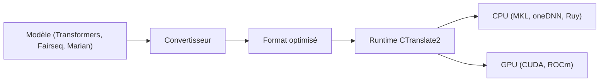

# OpenNMT/CTranslate2

> Moteur d'inférence C++ et Python rapide et économe pour modèles Transformer, sur CPU et GPU.

## Le problème
Les frameworks généralistes consomment beaucoup de mémoire et tournent lentement pour l'inférence de Transformers.

## Ce que ça fait vraiment
Un runtime dédié applique quantification (FP16, BF16, INT16, INT8, INT4 AWQ), fusion de couches et réordonnancement de lots. Il prend en charge des modèles encodeur-décodeur (NLLB, Whisper, T5), décodeur seul (Llama, Mistral, Gemma, Qwen2) et encodeur seul (BERT). Il choisit les backends CPU à l'exécution et supporte le parallélisme tensoriel.

## Comment c'est branché

Schéma simplifié d'après la fiche, sans diagramme fourni.

## Essayer
```bash
pip install ctranslate2
# Python :
# translator = ctranslate2.Translator(translation_model_path)
# translator.translate_batch(tokens)
```

## Coût et pièges
Gratuit. Les modèles doivent d'abord être convertis. Les benchmarks du README datent de la version 3.6.0 et d'une configuration précise ; ROCm demande des wheels dédiées.

## Ce que ce n'est pas
Ce n'est pas un framework d'entraînement ni un serveur prêt à l'emploi : il sert l'inférence. Le support TTS (Drama 3) est expérimental.

## Alternatives
Pas d'alternative nommée, mais le README compare OpenNMT-py, OpenNMT-tf, Marian, FasterTransformer et Transformers dans ses benchmarks.

## Pour toi
À adopter : si tu sers des modèles Transformer ou Whisper, c'est un gain mesuré en vitesse et en mémoire, installable avec pip.

