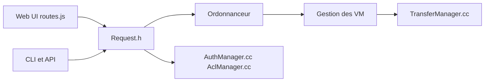

# OpenNebula/one

> Private, edge and hybrid cloud management platform for virtual machines, Kubernetes and GPU workloads.

## The problem
Running an infrastructure of virtual machines and clusters across several sites requires a unified control plane, with quotas and high availability.

## What it actually does
A C++ control plane: requests via web interface, CLI or REST/RPC API, scheduling, VM lifecycle, storage transfers, datastores and images, host monitoring, appliance marketplace, Kubernetes clusters, federation and high availability (Raft), authentication, ACLs and quotas. The README also announces an "AI Factory" component for GPU workloads, with no technical detail.

## How it is wired

## Trying it
No command in the README: it points to miniONE (single-server deployment) and to the installation guides in the official documentation.

## Cost and gotchas
Free, but a production installation relies on dedicated servers and external documentation. 771 open issues. The "AI Factory" component is not detailed in this text.

## What it is not
Not a standalone container orchestration tool nor a managed service: you operate the platform yourself. Not an MLOps platform: GPU support is described in one line.

## Alternatives
No alternative named in the README (it mentions use as a VMware replacement without naming a tool).

## For you
Ignore: a heavy infrastructure platform for operations teams, well beyond an ordinary data/AI need.
