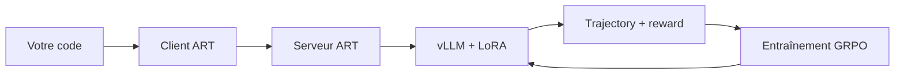

# OpenPipe/ART

> Python harness for reinforcement training (GRPO) of already-written multi-step LLM agents.

## The problem
An LLM agent that fails at a business task does not improve: all you can do is rewrite the prompt.
Building a home-grown RL loop requires vLLM, LoRA, GPU management and rollout orchestration.

## What it actually does
Splits an OpenAI-compatible **client** (in your code) from a **server** that runs on a GPU machine.
The client plays agentic rollouts; each message is stored in a `Trajectory` to which you
assign a `reward`. Trajectories are grouped and sent to the server, which trains with GRPO from
the latest checkpoint, saves the LoRA and reloads it into vLLM. A serverless W&B backend avoids a local GPU.

## How it is wired


## Trying it
```bash
pip install openpipe-art
```

## Cost and gotchas
The server requires a GPU, local or ephemeral. The "Serverless RL" mode goes through W&B Training and requires
a W&B `api_key`: billed to you, and a dependency on a third-party service.

## What it is not
Not an agent framework: ART slots into an existing application, it does not structure it.
Not a ready-to-use inference service. The claimed gains (40% cost, 28% speed) apply
to the commercial W&B offering, not to ART itself. No license is stated in the README.

## Alternatives
- **trl**: more general-purpose RLHF library, cited as an inspiration.
- **Unsloth**: efficient fine-tuning without the agentic loop.
- **torchtune**: native PyTorch training, without an agent harness.

## For you
Worth a look if you already have an agent in production with a measurable reward function; otherwise too early.
