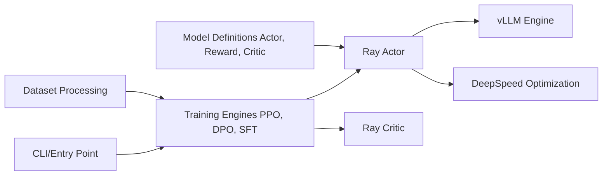

# OpenRLHF/OpenRLHF

> Distributed RLHF training framework (Ray + vLLM + DeepSpeed): SFT, reward model, PPO, GRPO, DPO.

## The problem
Aligning an LLM through reinforcement learning requires coordinating actor, critic, reward and reference across several GPUs, with sample generation dominating compute time.

## What it actually does
Ray distributes the models across GPUs; vLLM generates the rollouts; DeepSpeed ZeRO-3 trains; checkpoints are Hugging Face compatible.
Algorithms: PPO, REINFORCE++, GRPO, Dr. GRPO, RLOO, FlashREINFORCE; plus SFT, DPO/IPO, reward model.
Execution through token-in-token-out agents: single-turn with a custom Python `reward_func`, multi-turn with `reset/step`, OpenAI-compatible server.
Colocated Hybrid Engine, async mode, LoRA/QLoRA, VLM, MoE, packing, W&B/TensorBoard logs.

## How it is wired


## Trying it
```bash
docker run --runtime=nvidia -it --rm --shm-size="10g" --cap-add=SYS_ADMIN \
  -v $PWD:/openrlhf nvcr.io/nvidia/pytorch:26.03-py3 bash
pip install openrlhf[vllm]
ray start --head --node-ip-address 0.0.0.0 --num-gpus 8
deepspeed --module openrlhf.cli.train_sft --data.dataset Open-Orca/OpenOrca ...
```

## Cost and gotchas
Free, Apache-2.0; examples calibrated on 8x A100 80 GB. Async mode gains throughput at the cost of convergence stability.

## What it is not
Not a tool for a single small GPU nor a managed alignment API. The phrases "the first" and "production-ready" come from the README.

## Alternatives
None named in the README (Molt is an internal backend).

## For you
Adopt if you do post-training: the custom `reward_func` makes RLVR (math, code, format) accessible without a reward model, with a standard Ray/vLLM stack.
