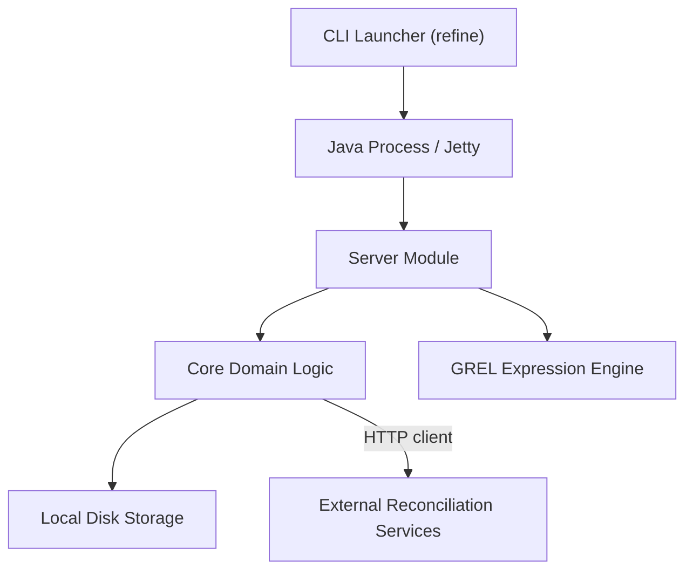

# OpenRefine/OpenRefine

> Local web application to load, clean, reconcile and enrich tabular datasets.

## The problem
Cleaning heterogeneous data (duplicates, spelling variants, formats) by hand in a spreadsheet is slow and not reproducible.

## What it actually does
A local Java server (Jetty) serves an interface in the browser. You import data, explore it with facets, transform it with the GREL language or Jython, and reconcile it with external services such as Wikibase. The operation history is kept and projects stay on the local disk.

## How it is wired


## Trying it
```bash
./refine        # Mac OS et Linux
refine.bat      # Windows
```

## Cost and gotchas
Free. Running from source requires JDK 11+, Maven and Node.js 18+; released versions can be downloaded from the releases. The project relies on grants and donations.

## What it is not
Not an automated pipeline tool nor an engine for very large volumes: it is an interactive desktop tool.

## Alternatives
No alternative named in the README.

## For you
Adopt: a proven, local tool to clean a dataset before training, without sending your data to the web.
