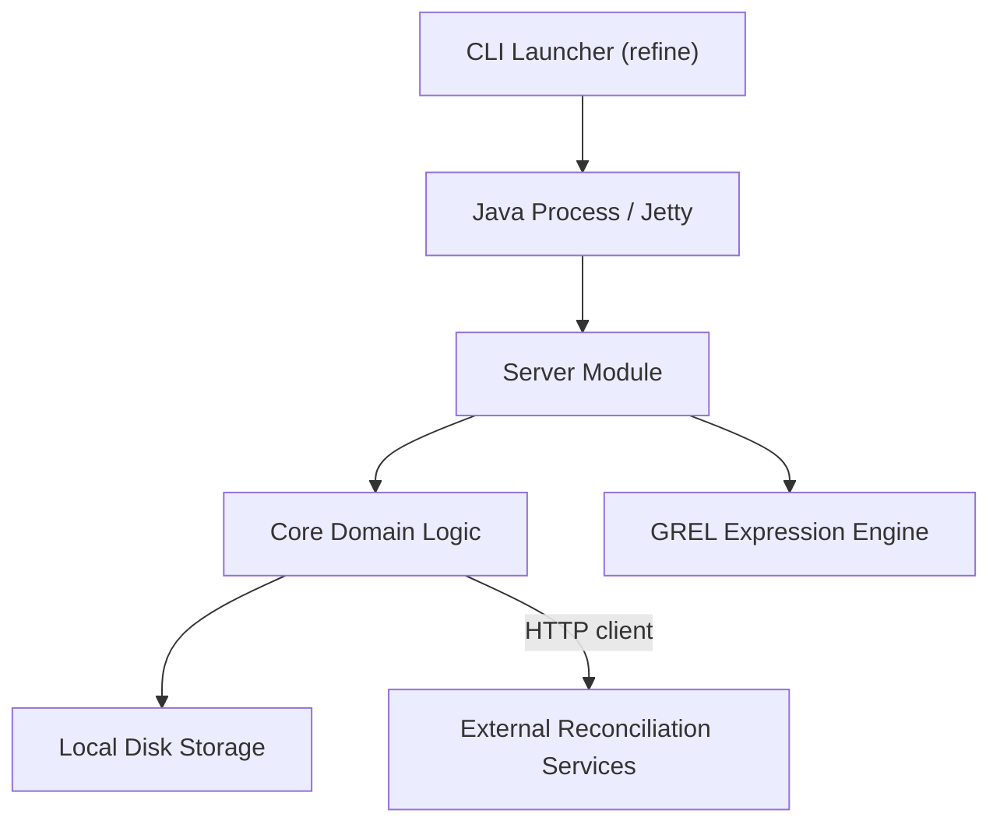

# OpenRefine/OpenRefine

> Application web locale pour charger, nettoyer, réconcilier et enrichir des jeux de données tabulaires.

## Le problème
Nettoyer des données hétérogènes (doublons, variantes d'écriture, formats) à la main dans un tableur est long et non reproductible.

## Ce que ça fait vraiment
Un serveur Java local (Jetty) sert une interface dans le navigateur. On importe des données, on les explore par facettes, on les transforme avec le langage GREL ou Jython, et on les réconcilie avec des services externes comme Wikibase. L'historique des opérations est conservé et les projets restent sur le disque local.

## Comment c'est branché


## Essayer
```bash
./refine        # Mac OS et Linux
refine.bat      # Windows
```

## Coût et pièges
Gratuit. Lancer depuis les sources demande JDK 11+, Maven et Node.js 18+ ; les versions publiées se téléchargent depuis les releases. Le projet repose sur des subventions et des dons.

## Ce que ce n'est pas
Pas un outil de pipeline automatisé ni un moteur pour très gros volumes : c'est un outil interactif de bureau.

## Alternatives
Aucune alternative nommée dans le README.

## Pour toi
À adopter : un outil éprouvé et local pour nettoyer un jeu de données avant entraînement, sans envoyer tes données sur le web.

