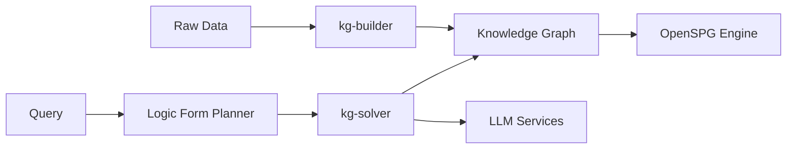

# OpenSPG/KAG

> Question-answering and logical reasoning framework over a knowledge graph, built on OpenSPG and an LLM.

## The problem
Vector RAG fails on multi-hop and logical questions; GraphRAG introduces noise through OpenIE extraction.

## What it actually does
Two parts: `kg-builder` builds a schema-constrained business graph, with a mutual index between graph nodes and the original text chunks; `kg-solver` translates a question into a logical form, then combines planning, reasoning and retrieval operators (exact match, text, numerical computation, semantic reasoning). Shipped as a product mode (web interface via Docker Compose) or a Python toolkit. `kag-model` is not published yet.

## How it is wired

(Diagram provided with no readable components: nodes taken from the explanation.)

## Trying it
```bash
curl -sSL https://raw.githubusercontent.com/OpenSPG/openspg/refs/heads/master/dev/release/docker-compose-west.yml -o docker-compose-west.yml
docker compose -f docker-compose-west.yml up -d
```

## Cost and gotchas
Docker and Docker Compose are required for the OpenSPG engine; the LLM is at your expense. Default credentials `openspg` / `openspg@kag` must be changed.

## What it is not
Not a lightweight RAG you plug in with one line: you have to model a schema and run the whole OpenSPG engine.

## Alternatives
No named alternative; RAG and GraphRAG are cited as compared approaches, not as repositories.

## For you
Worth watching if you have a highly structured business corpus where vector RAG fails; otherwise the setup cost (schema, full engine) outweighs the gain.
