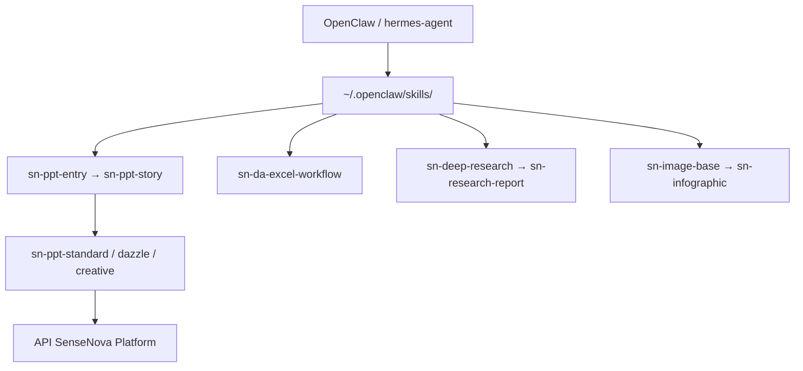

# OpenSenseNova/SenseNova-Skills

> Collection of office-productivity skills for agents: infographics, decks, Excel, deep research.

## The problem
A general-purpose agent can write, but cannot produce a compliant deck, a dense infographic or a reproducible multi-sheet Excel analysis.
Every team rewrites these chains in its own way.

## What it actually does
Each skill lives in its own directory with a `SKILL.md` declaring triggers, capabilities and execution flow, following the Agent Skills convention.
The PPT chain is explicit: `sn-ppt-entry` collects role, audience, page count and mode, `sn-ppt-story` produces the mandatory `outline.md`, then standard mode (HTML per page + VLM review + PPTX export), dynamic or creative.
`sn-da-excel-workflow` covers multi-sheet reading, large file detection (≥10k rows → Parquet), cleaning, cross-sheet aggregation and export.
`sn-deep-research` plans batches of parallel searches, reconciles contradictory figures between sources and produces a `report.md` with numbered citations.

## How it is wired


## Trying it
```bash
git clone https://github.com/OpenSenseNova/SenseNova-Skills.git --depth=1
mkdir -p ~/.openclaw/skills
cp -r SenseNova-Skills/skills/* ~/.openclaw/skills/
```
The README rather recommends asking the agent to install it itself, then restarting the service.

## Cost and gotchas
The skills are free but call the SenseNova API: key, base URL and model name must come from the same region (international or mainland China), otherwise you get 400/401 errors.
Python dependencies per category, Playwright and Chromium are required for rendering and PPTX export; a "doctor" skill exists per family to check them.

## What it is not
It is not an agent nor a model: it is instructions and scripts that assume an Agent Skills runtime.
It is not neutral either — part of the README sells Raccoon, the integrated product, and the "third-party quick try" entries are explicitly unsupported.

## Alternatives
- Raccoon: the packaged product from the same publisher, if you do not want to provision env, keys and runtimes.
- OpenClaw or hermes-agent: the recommended runtimes, to be chosen before the skills.

## For you
The data → research → deck chain is well divided and worth reading, even if you never plug in the SenseNova API.
