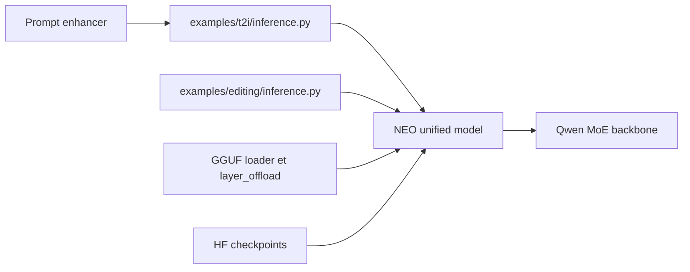

# OpenSenseNova/SenseNova-U1

> Family of unified multimodal models (image generation and editing, interleaved text, visual understanding).

## The problem
Multimodal systems often stitch together a vision encoder, a VAE and adapters; the author wants a single native model, from pixel to word.

## What it actually does
NEO-unify architecture with no vision encoder and no VAE. The repo provides inference scripts (text-to-image, editing, interleaved generation, VQA), optional prompt enhancement, GGUF loading and layer offloading for modest GPUs, a ComfyUI plugin, distributed training code and evaluations. Release U1.5-8B-MoT; acknowledged limits (dense text, hands, drift during editing).

## How it is wired


## Trying it
```bash
python examples/t2i/inference.py \
  --model_path sensenova/SenseNova-U1.5-8B-MoT \
  --prompt "A formal portrait depicts a man in 18th-century attire" \
  --output output.png
```

## Cost and gotchas
A GPU is required: the `--vram_mode` option and the Q4 GGUF target 10 to 12 GB. The recommended serving stack (LightLLM + LightX2V) is announced on H100/H200; the U1.5 "Lite" GGUF weights are "coming soon".

## What it is not
Not a ready-to-use service: the README also points to a free online studio. Community GGUFs are not maintained by the official team.

## Alternatives
LightLLM and LightX2V for serving; SenseNova-Skills (OpenClaw) for agent integration.

## For you
Worth watching: an open Apache-2.0 model that is interesting for local image generation and editing, to be evaluated on your GPU before any commitment.
