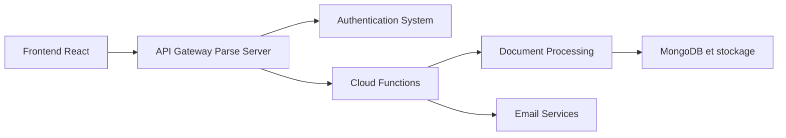

# OpenSign

> Open alternative to DocuSign: electronic PDF signing, self-hostable, for teams that sign contracts.

## The problem
Commercial e-signature services charge per use and keep documents with a third party.

## What it actually does
PDF signing (drawn, image, typed), multiple signers with enforced order, email OTP code for guests, expiry and rejection, templates, "Drive" vault, audit log and completion certificate, API and integrations (Zapier). Architecture: React front end, Parse Server, MongoDB, S3-compatible file storage.

## How it is wired


## Trying it
```bash
export HOST_URL=https://opensign.yourdomain.com && curl --remote-name-all https://raw.githubusercontent.com/OpenSignLabs/OpenSign/main/docker-compose.yml https://raw.githubusercontent.com/OpenSignLabs/OpenSign/main/Caddyfile https://raw.githubusercontent.com/OpenSignLabs/OpenSign/main/.env.local_dev && mv .env.local_dev .env.prod && docker compose up --force-recreate
```

## Cost and gotchas
Docker and git required. The default MongoDB database is not persistent and is wiped at each restart: provide your own URL. A free cloud version exists. A license is present but not identified by GitHub.

## What it is not
Not a legal validity guaranteed by the README: it says nothing about compliance (eIDAS, etc.).

## Alternatives
DocuSign, PandaDoc, SignNow, Adobe Sign, HelloSign, Zoho Sign: the commercial offerings the README cites as a point of comparison.

## For you
Worth watching: useful if you need to sign documents internally without SaaS, but outside the data/AI core, and the license needs confirming.
