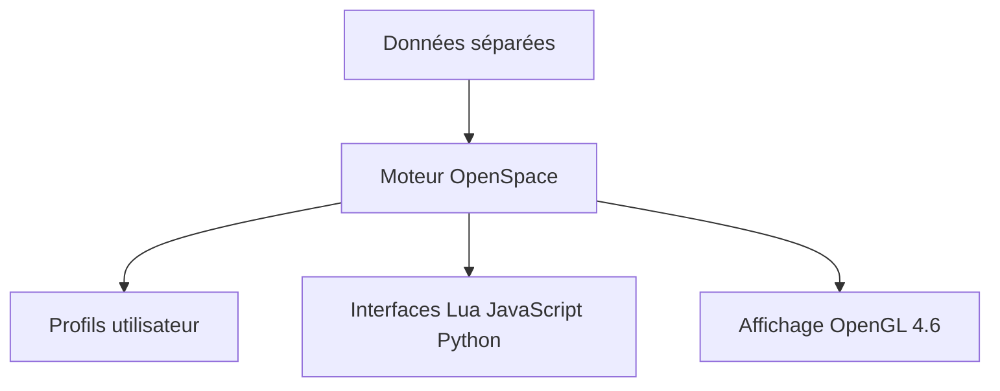

# OpenSpace/OpenSpace

> Open-source software for interactive visualization of the known universe, for the public, museums and scientists.

## The problem
Presenting astronomical data and space missions interactively, including on planetarium domes and video walls.

## What it actually does
It displays star and galaxy catalogs, planetary images and 3D models of missions (ISS, New Horizons, JWST). It drives single screens, multi-projector setups or planetariums, with custom profiles and Lua, JavaScript and Python interfaces. It also exports sessions as images for video. The repository does not contain the data.

## How it is wired
Simplified diagram based on the fiche, no diagram provided.

## Trying it
No command is given in the README: it points to the documentation for building. Prerequisites cited: CMake 4.0 or later, C++23 compiler (Visual Studio 2026, GCC15, Clang21).

## Cost and gotchas
Heavy build and OpenGL 4.6 required. macOS is not supported. A license is present but not identified by GitHub, while the README mentions MIT: to be checked.

## What it is not
Not a generic data analysis tool: it is astronomy visualization software. It does not run on Mac and does not contain its datasets.

## Alternatives
No alternative named in the README.

## For you
Ignore: a remarkable project, but unrelated to everyday data, AI or MLOps work, except for scientific space visualization.
