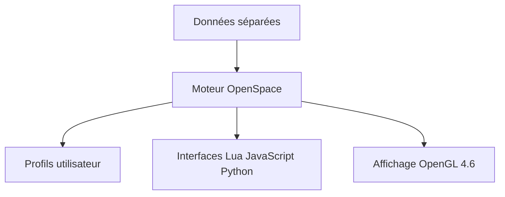

# OpenSpace/OpenSpace

> Logiciel libre de visualisation interactive de l'univers connu, pour le public, les musées et les scientifiques.

## Le problème
Présenter des données astronomiques et des missions spatiales de façon interactive, y compris sur dômes de planétarium et murs d'écrans.

## Ce que ça fait vraiment
Il affiche catalogues d'étoiles et de galaxies, images planétaires et modèles 3D de missions (ISS, New Horizons, JWST). Il pilote des écrans simples, multi-projecteurs ou planétariums, avec des profils personnalisés et des interfaces Lua, JavaScript et Python. Il exporte aussi les sessions en images pour la vidéo. Le dépôt ne contient pas les données.

## Comment c'est branché
Schéma simplifié d'après la fiche, sans diagramme fourni.

## Essayer
Aucune commande n'est donnée dans le README : il renvoie à la documentation pour la compilation. Prérequis cités : CMake 4.0 ou plus, compilateur C++23 (Visual Studio 2026, GCC15, Clang21).

## Coût et pièges
Compilation lourde et OpenGL 4.6 requis. macOS n'est pas supporté. Licence présente mais non identifiée par GitHub, alors que le README parle de MIT : à vérifier.

## Ce que ce n'est pas
Pas un outil d'analyse de données générique : c'est un logiciel de visualisation astronomique. Il ne tourne pas sur Mac et ne contient pas ses jeux de données.

## Alternatives
Aucune alternative nommée dans le README.

## Pour toi
À ignorer : projet remarquable, mais sans lien avec un travail data, IA ou MLOps courant, sauf visualisation scientifique spatiale.

