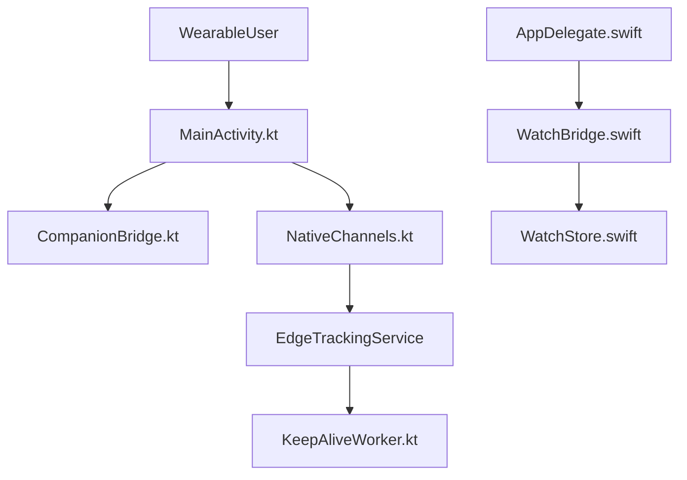

# OpenStrap/edge

> Open source mobile app to read data from a WHOOP band without a subscription, local by default.

## The problem
Health bands impose a subscription and send the data to the manufacturer's cloud.

## What it actually does
- Band pairing (WHOOP 4.0, 5.0, MG), sync and display of Today, Health, Sleep, Heart rate, Workout.
- Companion surfaces: Android/iOS widgets, Apple Watch, Shortcuts, Siri, Health Connect, HealthKit.
- Short README: the detail is deferred to docs/FEATURES.md, not provided; the main Flutter code is not in the described architecture.
- Other devices (Oura, Garmin...) announced as "under construction".

## How it is wired

## Trying it
No command documented in the README: the guides (development, iOS installation, sideload) are links that were not provided.

## Cost and gotchas
Free, but you must own a compatible band. iOS installation by sideload. Encrypted reports via a server worker (`osr1.py`), details not provided.

## What it is not
Not affiliated with WHOOP or the other brands. Not a finished multi-device platform. AGPL-3.0 license: strong copyleft if you modify and serve the code.

## Alternatives
None named in the README.

## For you
Worth watching: local biometric data, a lead for quantified-self, but a thin README and support limited to WHOOP.
