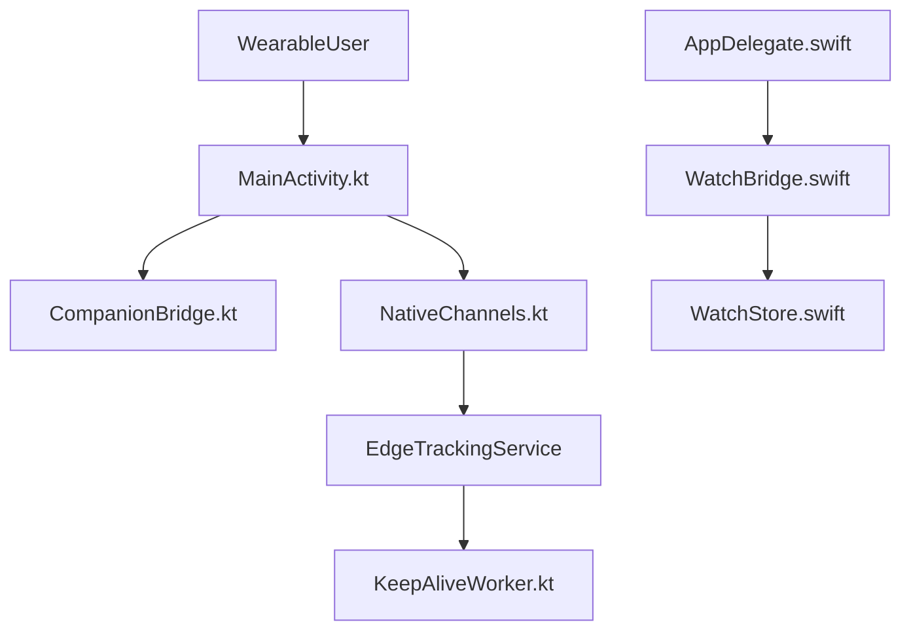

# OpenStrap/edge

> Application mobile open source pour lire les données d'un bracelet WHOOP sans abonnement, en local par défaut.

## Le problème
Les bracelets de santé imposent un abonnement et envoient les données dans le cloud du fabricant.

## Ce que ça fait vraiment
- Jumelage du bracelet (WHOOP 4.0, 5.0, MG), synchro et affichage Aujourd'hui, Santé, Sommeil, Fréquence cardiaque, Entraînement.
- Surfaces compagnes : widgets Android/iOS, Apple Watch, Raccourcis, Siri, Health Connect, HealthKit.
- README court : le détail est renvoyé vers docs/FEATURES.md, non fourni ; le code Flutter principal n'est pas dans l'architecture décrite.
- Autres appareils (Oura, Garmin...) annoncés « en construction ».

## Comment c'est branché

## Essayer
Aucune commande documentée dans le README : les guides (développement, installation iOS, sideload) sont des liens non fournis.

## Coût et pièges
Gratuit, mais il faut posséder un bracelet compatible. Installation iOS par sideload. Rapports chiffrés via un worker serveur (`osr1.py`), détails non fournis.

## Ce que ce n'est pas
Pas affilié à WHOOP ni aux autres marques. Pas une plateforme multi-appareils aboutie. Licence AGPL-3.0 : copyleft fort si tu modifies et sers le code.

## Alternatives
Aucune nommée dans le README.

## Pour toi
À surveiller : données biométriques locales, piste pour du quantified-self, mais README mince et support limité à WHOOP.

