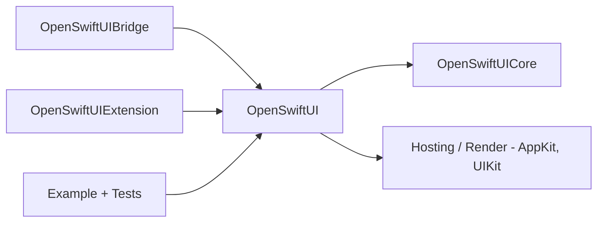

# OpenSwiftUIProject/OpenSwiftUI

> Open reimplementation of SwiftUI to build interfaces outside Apple platforms and to diagnose SwiftUI.

## The problem
SwiftUI is proprietary and limited to Apple platforms; its internal behavior is hard to debug.

## What it actually does
It aims for source compatibility with the SwiftUI API. `OpenSwiftUICore` is the engine (animation, layout, rendering), `OpenSwiftUI` is the API layer, `OpenSwiftUIBridge` is used to migrate other DSLs, and `OpenSwiftUIExtension` adds APIs. Integration layers (AppKit, UIKit) host the rendering. The README states that the project is in early development and makes heavy use of private Apple APIs.

## How it is wired


## Trying it
```bash
./Scripts/build
./Scripts/openswiftui_swiftinterface
Scripts/preview-documentation.sh
```

## Cost and gotchas
Recommended toolchain: Swift 6.3.3 / Xcode 26.6. Configuration goes through many environment variables. Clone OpenAttributeGraph alongside for the example. Do not use it in production on Apple platforms (private APIs, risk of breakage with every update).

## What it is not
It is not a complete SwiftUI nor supported by Apple. The README indicates use for learning and research, at your own risk.

## Alternatives
No alternative named in the README.

## For you
Ignore: an experimental Swift UI project, unrelated to data, AI or MLOps.
