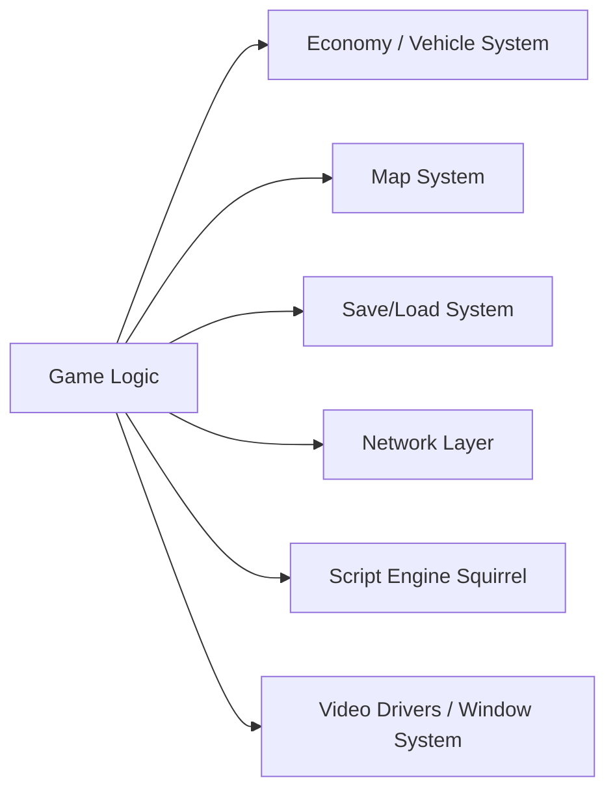

# OpenTTD/OpenTTD

> Transport simulation game inspired by Transport Tycoon Deluxe, for players.

## The problem
Replaying Transport Tycoon Deluxe on modern systems, with extensions and multiplayer.

## What it actually does
A simulation game that reproduces the original and adds features: cooperative or competitive multiplayer, additional content downloadable in-game (graphics, AI scripts), social integrations through plugins (Steam, Discord). It uses free sets of graphics, sounds and music, or those of the original.

## How it is wired

## Trying it
No documented command: download the stable or nightly version from the website, Steam, GOG or the Microsoft Store; compilation is described in COMPILING.md.

## Cost and gotchas
Free. Graphics and sound files are required (OpenGFX, OpenSFX, OpenMSX or those of the original). The README claims GPL 2.0 but GitHub does not identify the license: to be checked.

## What it is not
Not a professional tool: it is a game, with third-party code under other licenses.

## Alternatives
- No alternative named in the README.

## For you
Ignore: a video game unrelated to your data/AI work.
