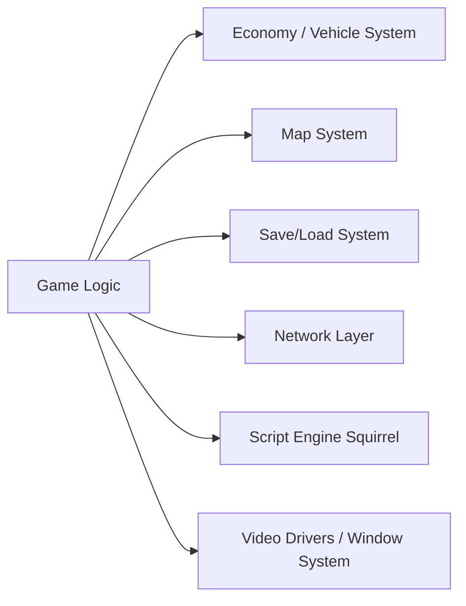

# OpenTTD/OpenTTD

> Jeu de simulation de transport inspiré de Transport Tycoon Deluxe, pour joueurs.

## Le problème
Rejouer à Transport Tycoon Deluxe sur des systèmes modernes, avec des extensions et du multijoueur.

## Ce que ça fait vraiment
Jeu de simulation qui reproduit l'original et y ajoute des fonctions : multijoueur coopératif ou compétitif, contenu additionnel téléchargeable en jeu (graphismes, scripts d'IA), intégrations sociales par plugins (Steam, Discord). Il utilise des jeux de graphismes, sons et musiques libres ou ceux de l'original.

## Comment c'est branché

## Essayer
Aucune commande documentée : télécharger la version stable ou nightly sur le site, Steam, GOG ou le Microsoft Store ; la compilation est décrite dans COMPILING.md.

## Coût et pièges
Gratuit. Il faut des fichiers de graphismes et de sons (OpenGFX, OpenSFX, OpenMSX ou ceux de l'original). Le README affirme la GPL 2.0 mais GitHub n'identifie pas la licence : à vérifier.

## Ce que ce n'est pas
Pas un outil professionnel : c'est un jeu, avec du code tiers sous d'autres licences.

## Alternatives
- Aucune alternative nommée dans le README.

## Pour toi
À ignorer : jeu vidéo sans rapport avec ton métier data/IA.

