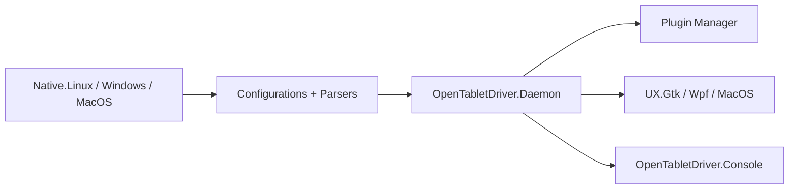

# OpenTabletDriver/OpenTabletDriver

> Open source, cross-platform, user-mode graphics tablet driver, with a daemon and an interface.

## The problem
Manufacturer drivers for tablets (Wacom, XP-Pen, Huion...) are heavy, proprietary and uneven across operating systems.

## What it actually does
A daemon reads the tablet's raw reports through native libraries per OS, interprets them with per-model JSON configurations, applies filters and plugins, then drives the cursor. The interface (WPF, GTK or MacOS) and the console talk to the daemon over RPC.

## How it is wired


## Trying it
```bash
./eng/bash/package.sh
./eng/bash/package.sh --package Debian
./build.sh linux
```

## Cost and gotchas
Free. Building requires the .NET 10 SDK and system packages (libx11, libevdev2, GTK+3 on Linux). On Windows, Windows Ink output requires a plugin and the VMulti driver. Signing is mandatory for macOS arm64 packages.

## What it is not
Not drawing software. Not a data or AI tool. Support depends on the model being present in the configurations.

## Alternatives
No alternative named in the README.

## For you
Ignore: useful if you have a graphics tablet, outside your data / AI / MLOps scope.
