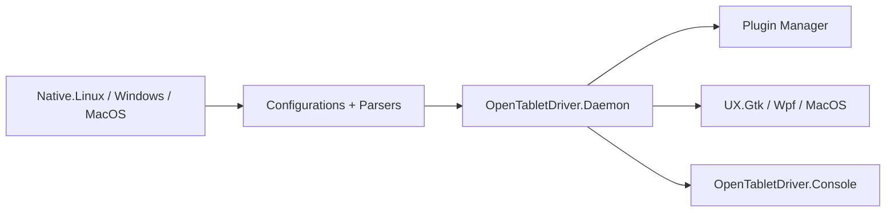

# OpenTabletDriver/OpenTabletDriver

> Pilote de tablette graphique open source, multiplateforme, en mode utilisateur, avec daemon et interface.

## Le problème
Les pilotes constructeurs de tablettes (Wacom, XP-Pen, Huion…) sont lourds, propriétaires et inégaux selon l'OS.

## Ce que ça fait vraiment
Un daemon lit les rapports bruts de la tablette via des bibliothèques natives par OS, les interprète avec des configurations JSON par modèle, applique filtres et plugins puis pilote le curseur. L'interface (WPF, GTK ou MacOS) et la console parlent au daemon par RPC.

## Comment c'est branché


## Essayer
```bash
./eng/bash/package.sh
./eng/bash/package.sh --package Debian
./build.sh linux
```

## Coût et pièges
Gratuit. Compiler demande le SDK .NET 10 et des paquets système (libx11, libevdev2, GTK+3 sur Linux). Sur Windows, la sortie Windows Ink exige un plugin et le pilote VMulti. Signature obligatoire des paquets macOS arm64.

## Ce que ce n'est pas
Pas un logiciel de dessin. Pas un outil data ou IA. Le support dépend de la présence du modèle dans les configurations.

## Alternatives
Aucune alternative nommée dans le README.

## Pour toi
Ignorer : utile si tu as une tablette graphique, hors de ton périmètre data / IA / MLOps.

