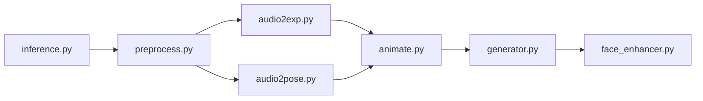

# OpenTalker/SadTalker

> Generates a talking-face video from an image and an audio clip (CVPR 2023).

## The problem
Animating a portrait with a voice, with coherent 3D head and expression motion, is hard.

## What it actually does
Prepares the portrait, extracts 3D coefficients, predicts expression and pose from the audio, then a neural generator produces the frames, with optional face enhancement (GFPGAN). Modes: still, full frame, resize, reference. Gradio interface, stable-diffusion-webui extension, CLI.

## How it is wired


## Trying it
```bash
git clone https://github.com/OpenTalker/SadTalker.git
conda create -n sadtalker python=3.8
pip install -r requirements.txt
bash scripts/download_models.sh
python inference.py --driven_audio <audio.wav> --source_image <video.mp4 or picture.png> --enhancer gfpgan
```

## Cost and gotchas
Old environment (Python 3.8, torch 1.12 / CUDA 11.3), weights to download. Last push in June 2024, 665 open issues. License not identified by GitHub (the README states Apache 2.0). Misuse is prohibited by the disclaimer.

## What it is not
Not an official Tencent product; no legal guarantee on the outputs.

## Alternatives
In the related work: StyleHEAT, VideoReTalking, DPE, CodeTalker.

## For you
Look at it as a research reference; poorly maintained with old dependencies, not recommended in production.
