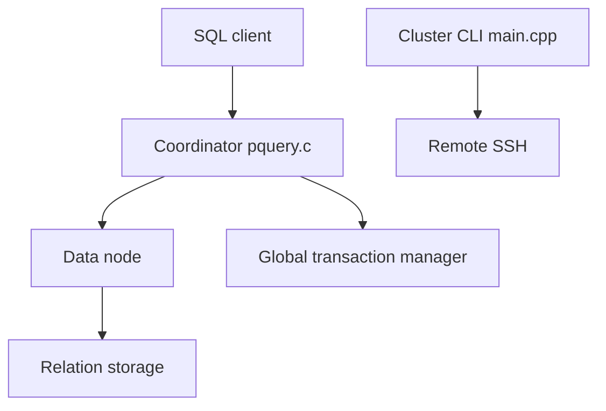

# OpenTenBase/OpenTenBase

> Distributed SQL database derived from Postgres-XL, used at Tencent.

## The problem
Scaling a Postgres database across several machines requires a distributed engine with global transaction management.

## What it actually does
Cluster of coordinators, data nodes and GTM nodes (global transactions). The client connects to the coordinator, which distributes query fragments across the data nodes. The `opentenbase_ctl` tool installs and drives the cluster over SSH.

## How it is wired


## Trying it
```bash
opentenbase_ctl install -c opentenbase_config.ini
opentenbase_ctl start -c opentenbase_config.ini
opentenbase_ctl status -c opentenbase_config.ini
psql -h ${CoordinateNode_IP} -p ${CoordinateNode_PORT} -U opentenbase -d postgres
```

## Cost and gotchas
8 GB of RAM minimum, compilation from source on TencentOS, CentOS or Ubuntu 18.04. Passwordless SSH access, dedicated user, SELinux and firewall to disable. License present but not identified by GitHub.

## What it is not
Not a simple Postgres: heavy, multi-node installation. `install` does not start the cluster.

## Alternatives
- PostgreSQL: cited for compatible language interfaces.
- Postgres-XL: the project it derives from.

## For you
Ignore: heavy installation, license to verify, and a data / AI profile has better routes for large-scale SQL.
