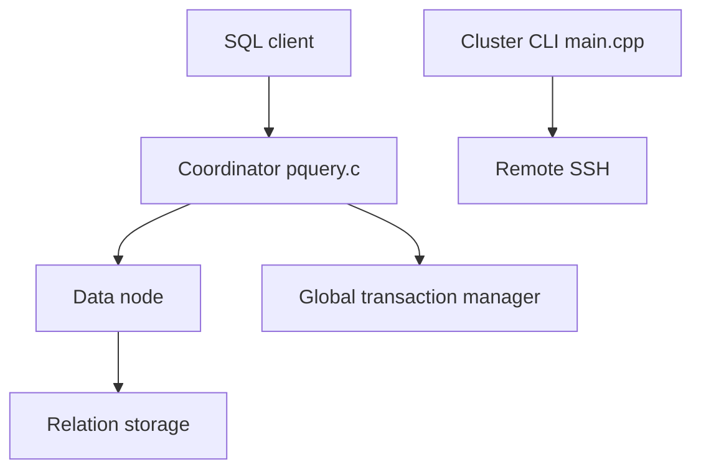

# OpenTenBase/OpenTenBase

> Base de données SQL distribuée, dérivée de Postgres-XL, utilisée chez Tencent.

## Le problème
Faire passer une base Postgres à l'échelle sur plusieurs machines demande un moteur distribué avec gestion de transactions globales.

## Ce que ça fait vraiment
Cluster de coordinateurs, de nœuds de données et de nœuds GTM (transactions globales). Le client se connecte au coordinateur, qui répartit les fragments de requête sur les nœuds de données. L'outil `opentenbase_ctl` installe et pilote le cluster en SSH.

## Comment c'est branché


## Essayer
```bash
opentenbase_ctl install -c opentenbase_config.ini
opentenbase_ctl start -c opentenbase_config.ini
opentenbase_ctl status -c opentenbase_config.ini
psql -h ${CoordinateNode_IP} -p ${CoordinateNode_PORT} -U opentenbase -d postgres
```

## Coût et pièges
8 Go de RAM minimum, compilation depuis les sources sur TencentOS, CentOS ou Ubuntu 18.04. Accès SSH sans mot de passe, utilisateur dédié, SELinux et pare-feu à désactiver. Licence présente mais non identifiée par GitHub.

## Ce que ce n'est pas
Pas un simple Postgres : installation lourde et multi-nœuds. `install` ne démarre pas le cluster.

## Alternatives
- PostgreSQL : cité pour les interfaces de langage compatibles.
- Postgres-XL : le projet dont il est issu.

## Pour toi
Ignorer : installation lourde, licence à vérifier, et un profil data / IA a de meilleures voies pour du SQL à grande échelle.

