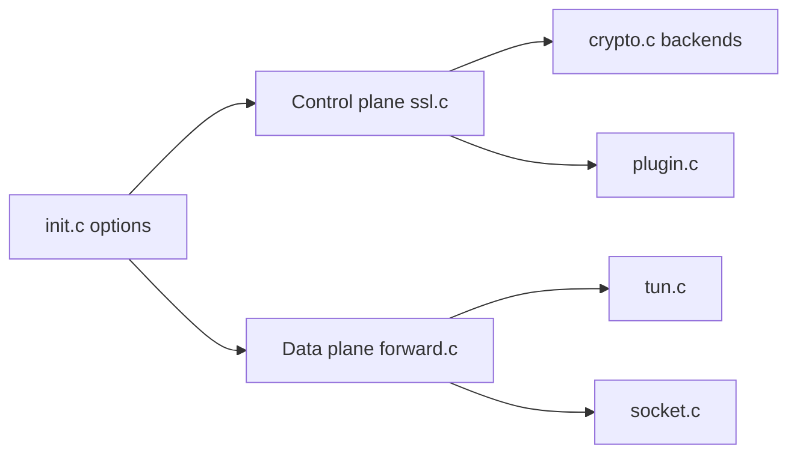

# OpenVPN/openvpn

> TLS-encrypted VPN tunnel daemon over UDP/TCP, for network administrators.

## The problem
Securely linking machines or sites across a public network.

## What it actually does
A C daemon: control plane (TLS, authentication, pushed options) and data plane (TUN/TAP interface, sockets, fragmentation, encryption). OpenSSL or mbedTLS crypto backends, PKCS#11, plugins (auth-pam, down-root), DCO kernel offload. Windows components: service, MSI, `tapctl`.

## How it is wired


## Trying it
```bash
tar -zxf openvpn-<version>.tar.gz
cd openvpn-<version>
./configure
make
make install
```

## Cost and gotchas
Free. The README states GPL v2 (copyleft) while GitHub does not recognize the license. The example keys are deliberately insecure. Easy-rsa and tap-windows are in other repositories.

## What it is not
Not a graphical client nor a managed service.

## Alternatives
No alternative named in the README.

## For you
Adopt if you must link environments (GPU, on-prem) with a VPN: proven, but check the GPL license regarding redistribution.
