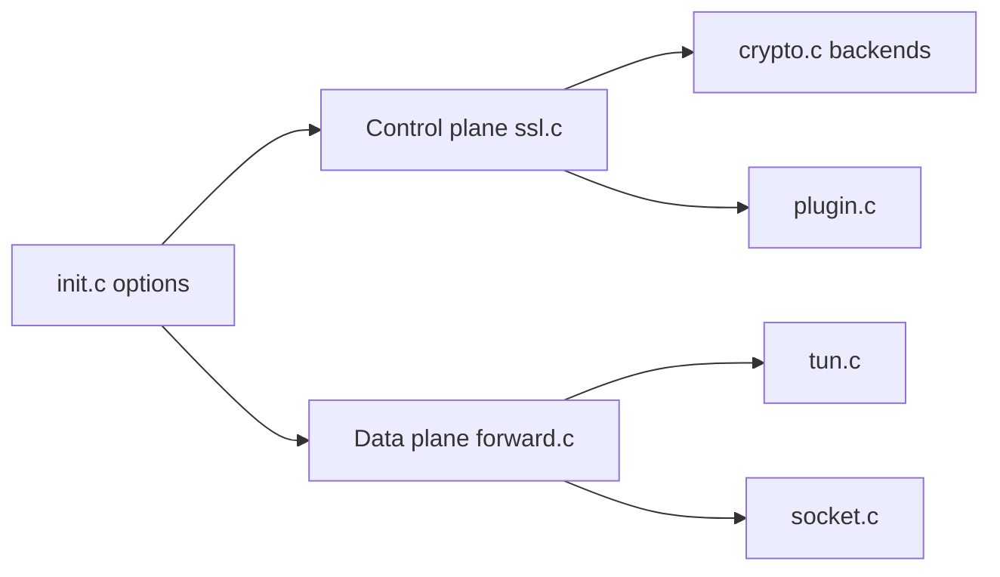

# OpenVPN/openvpn

> Démon de tunnel VPN chiffré en TLS sur UDP/TCP, pour administrateurs réseau.

## Le problème
Relier des machines ou des sites de façon sécurisée à travers un réseau public.

## Ce que ça fait vraiment
Un démon C : plan de contrôle (TLS, authentification, options poussées) et plan de données (interface TUN/TAP, sockets, fragmentation, chiffrement). Backends crypto OpenSSL ou mbedTLS, PKCS#11, plugins (auth-pam, down-root), offload noyau DCO. Composants Windows : service, MSI, `tapctl`.

## Comment c'est branché


## Essayer
```bash
tar -zxf openvpn-<version>.tar.gz
cd openvpn-<version>
./configure
make
make install
```

## Coût et pièges
Gratuit. Le README annonce la GPL v2 (copyleft) alors que GitHub ne reconnaît pas la licence. Les clés d'exemple sont volontairement non sûres. Easy-rsa et tap-windows sont dans d'autres dépôts.

## Ce que ce n'est pas
Pas un client graphique ni un service géré.

## Alternatives
Aucune alternative nommée dans le README.

## Pour toi
Adopter si tu dois relier des environnements (GPU, on-prem) en VPN : éprouvé, mais vérifier la licence GPL côté redistribution.

