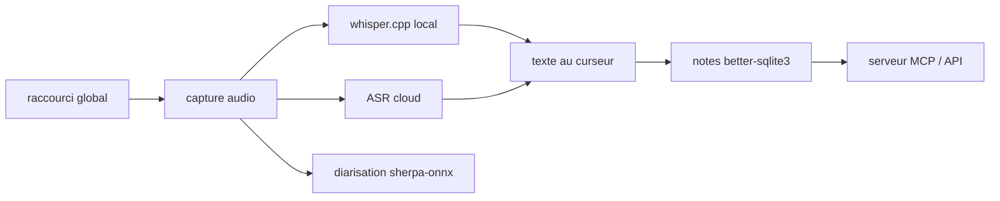

# OpenWhispr/openwhispr

> Desktop voice dictation and meeting transcription, with local transcription possible.

## The problem
Dictation and meeting-note tools send the audio to a third party, which rules out any confidential content.

## What it actually does
Global shortcut: you speak, the text appears at the cursor in any application; a second shortcut translates on the fly.
Meeting transcription with automatic detection of Zoom, Teams and FaceTime, live diarization, voice fingerprints, calendar integration.
Notes with folders, semantic search, sync, team spaces and web sharing.
Local models (Whisper via whisper.cpp, NVIDIA Parakeet via sherpa-onnx, Orukeet, Cohere Transcribe) or cloud providers, selectable for each feature.

## How it is wired


## Trying it
```bash
git clone https://github.com/OpenWhispr/openwhispr.git
cd openwhispr
npm install
npm run dev
```

## Cost and gotchas
Local is free, but the AI agent and cloud features go through billed providers (GPT-5, Claude, Gemini, Groq, OpenRouter). Node.js 24+ to build. On Intel Mac, no speaker identification or voice fingerprint: ONNX Runtime no longer ships x86_64 binaries since 1.24, and note search falls back to keywords.

## What it is not
Not fully local by default: the local/cloud choice is per feature, and team spaces go through OpenWhispr Cloud (Neon Postgres). Not a service: it is an Electron application to install machine by machine. Not a replacement for a video-conferencing tool: it listens, it does not participate.

## Alternatives
WisprFlow and Granola — the two products the README presents itself as the open alternative to.

## For you
The best candidate for dictating and transcribing without letting the audio leave, provided you stay on the local models.
