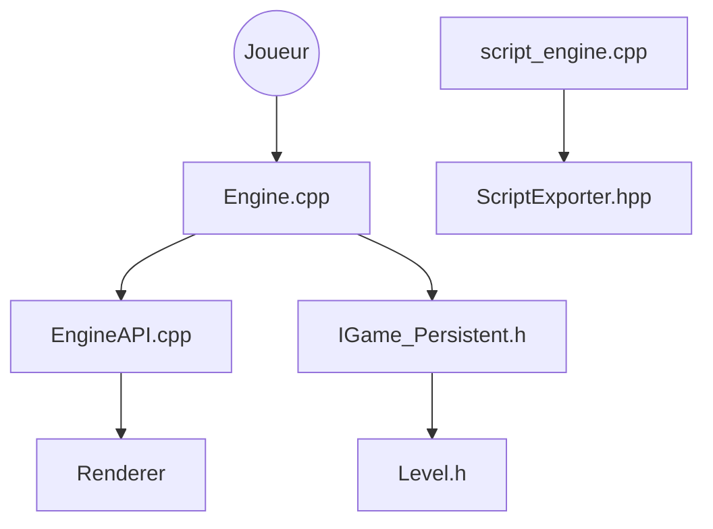

# OpenXRay/xray-16

> Improved version of the S.T.A.L.K.E.R. X-Ray engine, for players and mod creators.

## The problem
The original engine is 32-bit, buggy and limited to Windows, which holds back play and modding.

## What it actually does
- 64-bit engine, faster, with bug fixes.
- Runs on Linux, macOS, BSD and several architectures (ARM, ARM64, E2K, PPC64LE).
- Aims to be a drop-in replacement, compatible with the three games of the series.
- Tools for modders: render graph, scripts, SDK.

## How it is wired

## Trying it
No command in the README: installation and building are described on the wiki.

## Cost and gotchas
Free. You must own the original game's resources (not stated in the README); the `dev` branch is sometimes broken. A license is present but not identified by GitHub.

## What it is not
Not affiliated with GSC Game World. It is not a complete game: it is an engine. Mods must follow GSC's EULA.

## Alternatives
No alternative named in the README.

## For you
Ignore: a video game project, unrelated to data / AI / MLOps pipelines.
