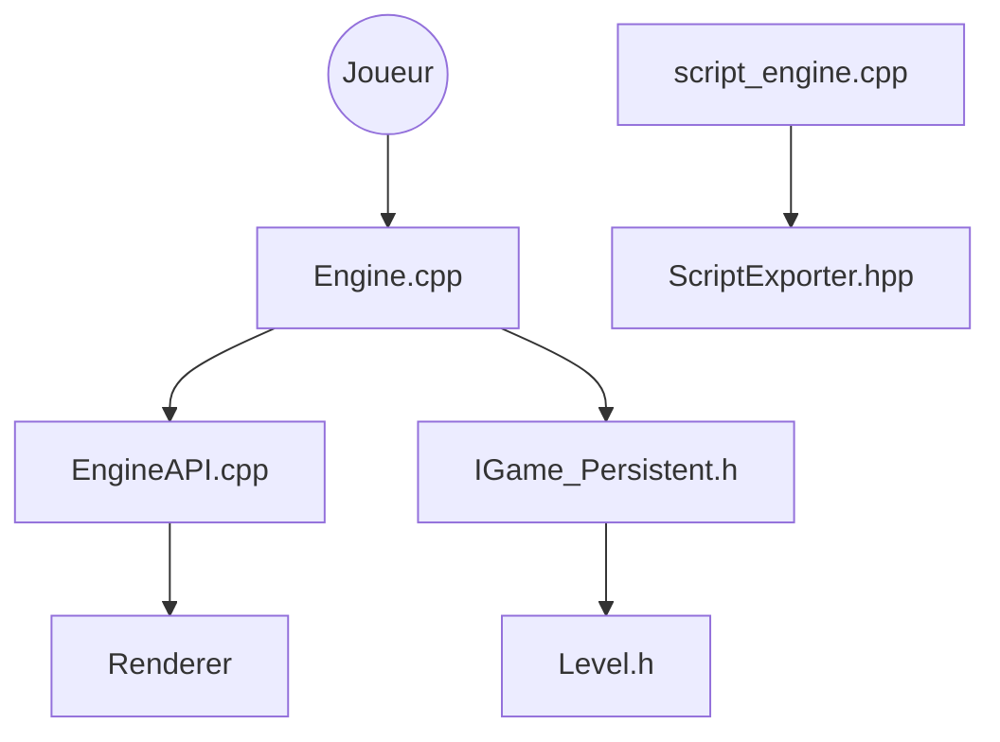

# OpenXRay/xray-16

> Version améliorée du moteur X-Ray de S.T.A.L.K.E.R., pour joueurs et créateurs de mods.

## Le problème
Le moteur d'origine est 32 bits, bogué et limité à Windows, ce qui freine jeu et modding.

## Ce que ça fait vraiment
- Moteur 64 bits, plus rapide, avec corrections de bogues.
- Fonctionne sous Linux, macOS, BSD et plusieurs architectures (ARM, ARM64, E2K, PPC64LE).
- Vise un remplacement direct, compatible avec les trois jeux de la série.
- Outils pour moddeurs : graphe de rendu, scripts, SDK.

## Comment c'est branché

## Essayer
Aucune commande dans le README : installation et compilation sont décrites sur le wiki.

## Coût et pièges
Gratuit. Il faut posséder les ressources du jeu d'origine (non précisé dans le README) ; branche `dev` parfois cassée. Licence présente mais non identifiée par GitHub.

## Ce que ce n'est pas
Pas affilié à GSC Game World. Ce n'est pas un jeu complet : c'est un moteur. Les mods doivent suivre l'EULA de GSC.

## Alternatives
Aucune alternative nommée dans le README.

## Pour toi
À ignorer : projet de jeu vidéo, sans lien avec les chaînes data / IA / MLOps.

