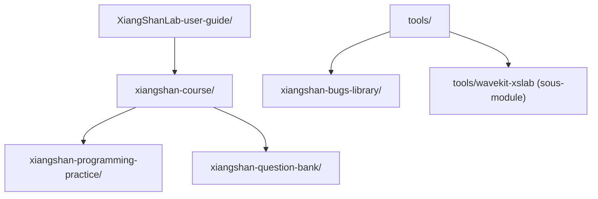

# OpenXiangShan/XiangShanLab

> Repository of courses, exercises and tools for learning and verifying the XiangShan RISC-V processor.

## The problem
Learning the design and verification of a high-performance RISC-V processor requires a structured path.

## What it actually does
The repository gathers about fifteen course chapters (environment, Scala and Chisel, RISC-V specification, microarchitecture, bugs, cache coherence, DDR, security), hands-on exercises, a question bank, bug cases and code and waveform analysis tools for agents, with `SKILL.md` files. The README is in Chinese.

## How it is wired
Simplified diagram based on the sheet, no diagram provided.


## Trying it
```bash
git clone --recursive https://github.com/OpenXiangShan/XiangShanLab.git
cd XiangShanLab
git submodule update --init --recursive
```

## Cost and gotchas
The `wavekit-xslab` submodule requires a recursive clone. Licenses vary by folder: the course is Apache-2.0 for code and CC BY-NC 4.0 for documents, but the repository declares none at the root level.

## What it is not
Not the processor repository: the RTL is in OpenXiangShan/XiangShan.

## Alternatives
No alternative named in the README.

## For you
Ignore: processor design, outside the data, AI and MLOps scope, except for curiosity about the agent tools.
