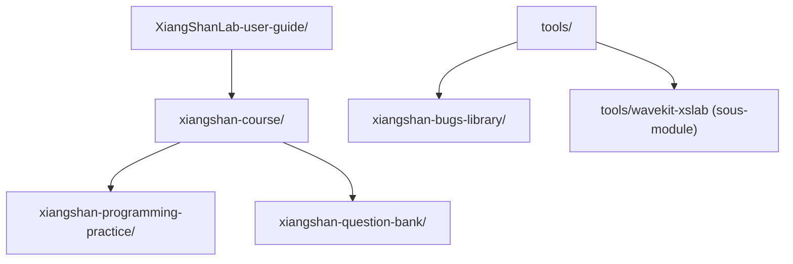

# OpenXiangShan/XiangShanLab

> Dépôt de cours, exercices et outils pour apprendre et vérifier le processeur RISC-V XiangShan.

## Le problème
Apprendre la conception et la vérification d'un processeur RISC-V haute performance demande un parcours structuré.

## Ce que ça fait vraiment
Le dépôt réunit une quinzaine de chapitres de cours (environnement, Scala et Chisel, spécification RISC-V, microarchitecture, bugs, cohérence de cache, DDR, sécurité), des exercices pratiques, une banque de questions, des cas de bugs et des outils d'analyse de code et de formes d'onde pour agents, avec des fichiers `SKILL.md`. Le README est en chinois.

## Comment c'est branché
Schéma simplifié d'après la fiche, sans diagramme fourni.


## Essayer
```bash
git clone --recursive https://github.com/OpenXiangShan/XiangShanLab.git
cd XiangShanLab
git submodule update --init --recursive
```

## Coût et pièges
Le sous-module `wavekit-xslab` exige un clonage récursif. Les licences varient selon les dossiers : le cours est en Apache-2.0 pour le code et CC BY-NC 4.0 pour les documents, mais le dépôt n'en déclare pas au niveau racine.

## Ce que ce n'est pas
Pas le dépôt du processeur : le RTL est dans OpenXiangShan/XiangShan.

## Alternatives
Aucune alternative nommée dans le README.

## Pour toi
À ignorer : conception de processeurs, hors du champ data, IA et MLOps, sauf curiosité pour les outils d'agents.

