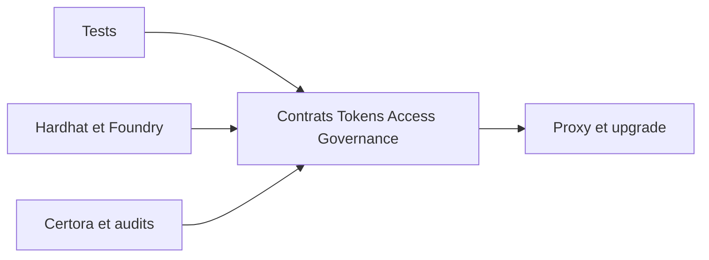

# OpenZeppelin/openzeppelin-contracts-upgradeable

> "Upgradeable" version of the OpenZeppelin Solidity contracts: ERC20, ERC721, access, governance.

## The problem
Hand-writing token and permission contracts is risky; making them upgradeable requires strict storage management.

## What it actually does
Provides reusable contracts (ERC20, ERC721, ERC1155, ERC6909, role-based access control, utilities) adapted to proxies, with `initialize` functions instead of constructors. npm tags: `latest` (audited), `dev` (finished but unaudited), `next` (candidate).

## How it is wired


## Trying it
```bash
npm install @openzeppelin/contracts-upgradeable
forge install OpenZeppelin/openzeppelin-contracts-upgradeable
```

## Cost and gotchas
The README warns that storage layouts of different major versions are incompatible (4.9.3 to 5.0.0 is dangerous). Under Foundry, `forge update` switches to `master`: prefer tags. Do not copy or modify the code.

## What it is not
It is not an audit of your code; the README says so and disclaims any warranty (MIT).

## Alternatives
- `@openzeppelin/contracts`: the non-upgradeable version, preferable if you do not use a proxy.

## For you
Ignore: blockchain contracts with no role in data, AI or MLOps work.
