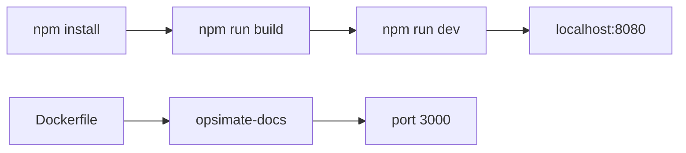

# OpsiMate/documentation

> Sources of the documentation site for OpsiMate, a monitoring tool for DevOps, NOC and IT teams.

## The problem
Without this repository, OpsiMate's documentation can be neither viewed nor edited locally.

## What it actually does
It contains the documentation site, built with npm, served locally on port 8080. A Dockerfile builds it from the root, because the image needs the workspace's `package-lock.json`. The README describes OpsiMate as a single place to see service health, open dashboards and launch starts, stops or restarts.

## How it is wired

Simplified diagram based on the sheet, no diagram provided.

## Trying it
```bash
npm install
npm run build
npm run dev
docker build -t opsimate-docs .
docker run -p 3000:3000 --env-file .env opsimate-docs
```

## Cost and gotchas
Free, Node required. The container expects a `.env` file whose content is not documented. The README is short: insufficient material.

## What it is not
Not the OpsiMate tool itself, only its documentation. GPL-3.0 license (copyleft).

## Alternatives
No alternative named in the README.

## For you
Ignore: it is only the documentation site, of no interest unless you use OpsiMate.
