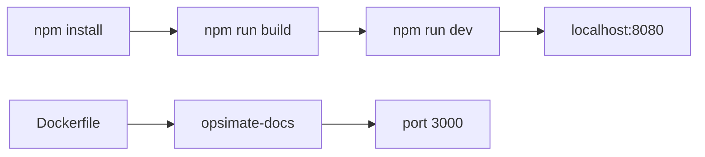

# OpsiMate/documentation

> Sources du site de documentation d'OpsiMate, outil de supervision pour équipes DevOps, NOC et IT.

## Le problème
Sans ce dépôt, la documentation d'OpsiMate n'est pas consultable ni modifiable en local.

## Ce que ça fait vraiment
Il contient le site de documentation, construit avec npm, servi en local sur le port 8080. Un Dockerfile le construit depuis la racine, car l'image a besoin du `package-lock.json` du workspace. Le README décrit OpsiMate comme un point unique pour voir la santé des services, ouvrir des tableaux de bord et lancer des démarrages, arrêts ou redémarrages.

## Comment c'est branché

Schéma simplifié d'après la fiche, sans diagramme fourni.

## Essayer
```bash
npm install
npm run build
npm run dev
docker build -t opsimate-docs .
docker run -p 3000:3000 --env-file .env opsimate-docs
```

## Coût et pièges
Gratuit, Node requis. Le conteneur attend un fichier `.env` dont le contenu n'est pas documenté. Le README est court : matière insuffisante.

## Ce que ce n'est pas
Ce n'est pas l'outil OpsiMate lui-même, seulement sa documentation. Licence GPL-3.0 (copyleft).

## Alternatives
Aucune alternative nommée dans le README.

## Pour toi
À ignorer : ce n'est que le site de documentation, sans intérêt tant que tu n'utilises pas OpsiMate.

