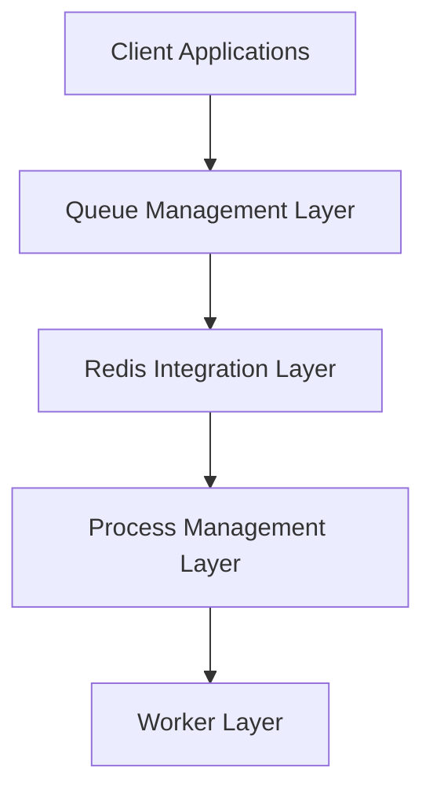

# OptimalBits/bull

> Redis-backed Node.js job queue: retries, priorities, cron jobs.

## The problem
A Node app needs reliable background processing, with retries, delays and crash recovery.

## What it actually does
Queues are stored in Redis with atomic operations (Lua scripts) and no polling.
It handles delayed jobs, cron repeats, rate limiting, priorities and concurrency.
Workers can run in separate, isolated processes.
Delivery is "at least once": a job can be processed twice if it loses its lock.

## How it is wired


## Trying it
```bash
npm install bull --save
yarn add bull
npm install @types/bull --save-dev
```

## Cost and gotchas
Redis 2.8.18 or later is required. The official interface, Taskforce.sh, is paid. You need to watch the `stalled` event.

## What it is not
Not the active version: the README table promotes BullMQ. The code is Node, not Python.

## Alternatives
- BullMQ: successor, with parent/child dependencies.
- Kue, Bee (Redis) or Agenda (Mongo): simpler but less complete.

## For you
Ignore: it is a Node tool near the end of its life. For your Python pipelines, it is not relevant.
