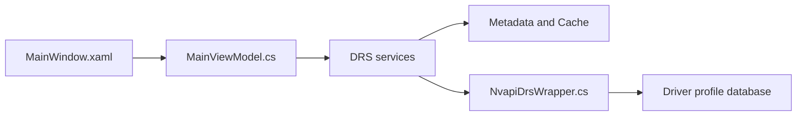

# Orbmu2k/nvidiaProfileInspector

> Windows tool to edit NVIDIA driver profiles, including hidden settings, for advanced gamers.

## The problem
The NVIDIA control panel does not expose all profile settings (DLSS, synchronization, filtering...).

## What it actually does
WPF application (.NET Framework 4.8) that reads and writes the driver's profile database through NVAPI. Global and per-application profiles, bit editor, favorites, `.nip` export/import, command-line options (`-silentImport`, `-exportCustomized`). Local only, no server.

## How it is wired


## Trying it
```bash
nvidiaProfileInspector.exe -exportCustomized
nvidiaProfileInspector.exe -silentImport ".\ProfileA.nip"
```

## Cost and gotchas
Free. Windows, NVIDIA driver and GPU, administrator rights required. Settings are sometimes undocumented or specific to a driver version: export before modifying.

## What it is not
Not a monitoring tool nor a CUDA or training tuning tool; it concerns game and graphics application profiles.

## Alternatives
No alternative named in the README.

## For you
Ignore: Windows graphics settings, no link with GPU compute for AI.
