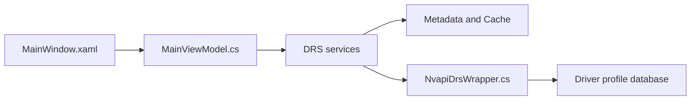

# Orbmu2k/nvidiaProfileInspector

> Outil Windows pour éditer les profils du pilote NVIDIA, y compris des réglages cachés, pour joueurs avancés.

## Le problème
Le panneau de configuration NVIDIA n'expose pas tous les réglages de profil (DLSS, synchronisation, filtrage…).

## Ce que ça fait vraiment
Application WPF (.NET Framework 4.8) qui lit et écrit la base de profils du pilote via NVAPI. Profils globaux et par application, éditeur de bits, favoris, export/import `.nip`, options en ligne de commande (`-silentImport`, `-exportCustomized`). Local uniquement, sans serveur.

## Comment c'est branché


## Essayer
```bash
nvidiaProfileInspector.exe -exportCustomized
nvidiaProfileInspector.exe -silentImport ".\ProfileA.nip"
```

## Coût et pièges
Gratuit. Windows, pilote et GPU NVIDIA, droits administrateur obligatoires. Réglages parfois non documentés ou propres à une version du pilote : exporter avant de modifier.

## Ce que ce n'est pas
Pas un outil de monitoring ni de réglage CUDA ou d'entraînement ; il concerne les profils de jeux et d'applications graphiques.

## Alternatives
Aucune alternative nommée dans le README.

## Pour toi
À ignorer : réglages graphiques Windows, pas de lien avec le calcul GPU pour l'IA.

