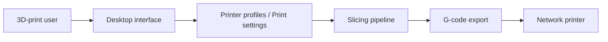

# OrcaSlicer/OrcaSlicer

> Free slicing software for 3D printing, with calibration and network printers.

## The problem
Turning a 3D model into precise toolpaths (G-code), adapted to the printer and the material.

## What it actually does
Loads a model, applies printer profiles and settings (walls, seams, supports, infill), slices it into layers, previews it and exports or sends the G-code (Klipper, PrusaLink, OctoPrint). Calibration tools, belt printers, IDEX/IQEX. Derived from Bambu Studio and PrusaSlicer.

## How it is wired


## Trying it
```bash
winget install --id=SoftFever.OrcaSlicer -e
brew install --cask orcaslicer
flatpak install flathub com.orcaslicer.OrcaSlicer
```

## Cost and gotchas
Free, AGPL-3.0. Windows binaries signed by SignPath. On Mac, PR builds require lifting the quarantine.

## What it is not
Not 3D modeling software: it slices existing models. The README's "most used" claim is not repeated here.

## Alternatives
The README cites PrusaSlicer, Bambu Studio, SuperSlicer and Cura as sources of inspiration.

## For you
Ignore: 3D printing, unrelated to data or AI.
