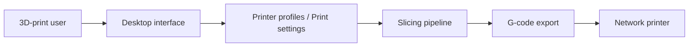

# OrcaSlicer/OrcaSlicer

> Logiciel libre de tranchage pour l'impression 3D, avec calibration et imprimantes réseau.

## Le problème
Préparer un modèle 3D en trajectoires d'outil (G-code) précises, adaptées à l'imprimante et au matériau.

## Ce que ça fait vraiment
Charge un modèle, applique profils d'imprimante et réglages (parois, coutures, supports, remplissage), tranche en couches, prévisualise et exporte ou envoie le G-code (Klipper, PrusaLink, OctoPrint). Outils de calibration, imprimantes à bande, IDEX/IQEX. Issu de Bambu Studio et PrusaSlicer.

## Comment c'est branché


## Essayer
```bash
winget install --id=SoftFever.OrcaSlicer -e
brew install --cask orcaslicer
flatpak install flathub com.orcaslicer.OrcaSlicer
```

## Coût et pièges
Gratuit, AGPL-3.0. Binaires Windows signés par SignPath. Sur Mac, les builds de PR demandent de lever la quarantaine.

## Ce que ce n'est pas
Pas un logiciel de modélisation 3D : il tranche des modèles existants. Le texte « le plus utilisé » du README n'est pas repris.

## Alternatives
Le README cite PrusaSlicer, Bambu Studio, SuperSlicer et Cura comme sources d'inspiration.

## Pour toi
À ignorer : impression 3D, sans lien avec data ou IA.

