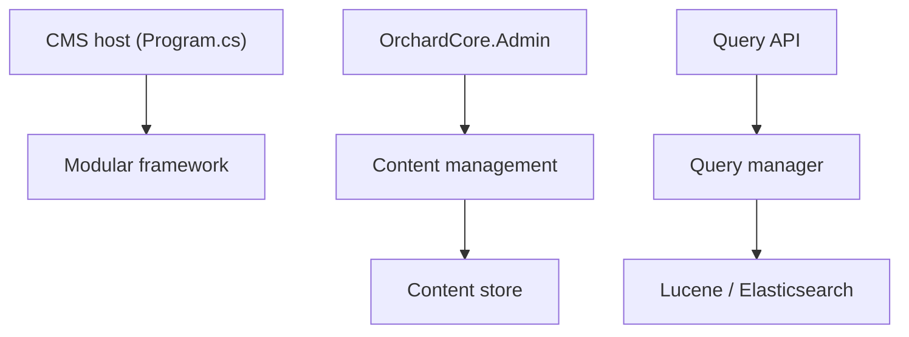

# OrchardCMS/OrchardCore

> Modular multi-tenant framework and CMS for ASP.NET Core, for .NET teams.

## The problem
Building a multi-client content site or application on .NET without starting from scratch.

## What it actually does
Two projects: a multi-tenant modular application framework, and a CMS built on top of it. The CMS offers content editing, fields, preview, an administration dashboard and a query API with Lucene or Elasticsearch backends. The architecture description states that the full request pipeline is not established.

## How it is wired


## Trying it
```bash
# Aucune commande dans le README : voir la documentation
# (getting started) et le Test drive cités.
```

## Cost and gotchas
Free. Requires the .NET ecosystem; the README points to the documentation for getting started. The preview feed is hosted by Cloudsmith.

## What it is not
Not a data/AI tool: it is a CMS. The README declares itself production-ready, but I draw no guarantee from that here.

## Alternatives
No alternative named in the README.

## For you
Ignore: .NET stack aimed at content sites, unrelated to data, AI or MLOps work.
