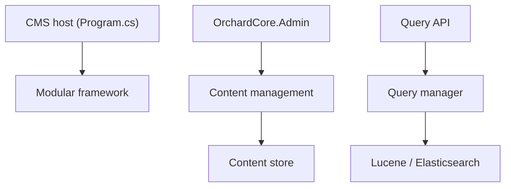

# OrchardCMS/OrchardCore

> Framework modulaire multi-tenant et CMS pour ASP.NET Core, pour équipes .NET.

## Le problème
Construire un site ou une application de contenu multi-clients sur .NET sans repartir de zéro.

## Ce que ça fait vraiment
Deux projets : un framework d'applications modulaires multi-tenant, et un CMS construit dessus. Le CMS offre édition de contenu, champs, prévisualisation, tableau de bord d'administration et une API de requêtes avec backends Lucene ou Elasticsearch. L'architecture décrite précise que le pipeline de requêtes complet n'est pas établi.

## Comment c'est branché


## Essayer
```bash
# Aucune commande dans le README : voir la documentation
# (getting started) et le Test drive cités.
```

## Coût et pièges
Gratuit. Nécessite l'écosystème .NET ; le README renvoie à la documentation pour le démarrage. Le flux de préversion est hébergé par Cloudsmith.

## Ce que ce n'est pas
Pas un outil data/IA : c'est un CMS. Le README se déclare prêt pour la production, mais je n'en tire aucune garantie ici.

## Alternatives
Aucune alternative nommée dans le README.

## Pour toi
À ignorer : stack .NET orientée sites de contenu, sans lien avec un travail data, IA ou MLOps.

