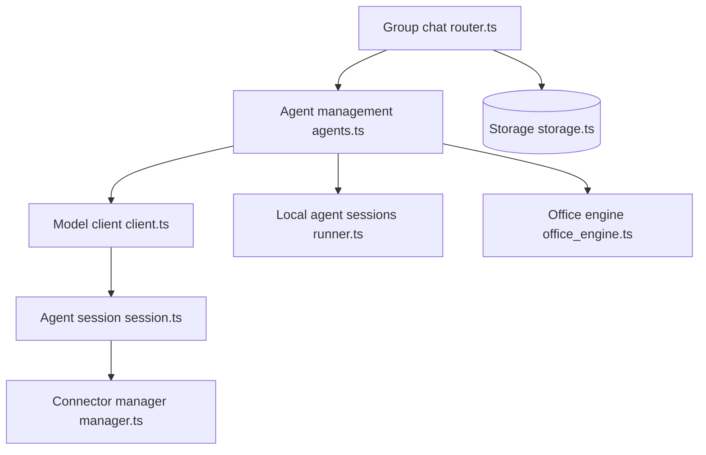

# Orkas-AI/Orkas

> Desktop app where a "Commander" orchestrates specialized agents and your Claude Code and Codex CLIs.

## The problem
You juggle several agents (code, research, content, Office files) with no shared project memory and no task tracking.

## What it actually does
- A Commander breaks a goal into to-dos and delegates via `dispatch_to`, `hand_off_to` and `run_worker`.
- 16 built-in agents (research, PPTX, video, UI, e-commerce, code) plus Claude Code, Codex, OpenCode, OpenClaw and Hermes-Agent launched as local subprocesses.
- Projects with memory, scheduled automations, connectors (Gmail, Slack, Notion, Stripe...) and a local SQLite vector index of documents.
- Data stays on your disk by default.

## How it is wired


## Trying it
```bash
git clone https://github.com/Orkas-AI/Orkas.git
cd Orkas
./run.sh           # macOS / Linux
run.cmd            # Windows
```
Then Settings → AI Providers to add an API key. Installer for macOS and Windows on the website.

## Cost and gotchas
Packaged app: account required, 500 free credits, then paid plans (from $11.99/month). Source version: your own keys, billed by the provider. First launch: heavy downloads (embedding model ~95 MB, FFmpeg, whisper.cpp). The built-in model goes through a managed service.

## What it is not
Not an LLM, not a framework to embed. Project sharing, cloud sync and web publishing exist only in the packaged app, not in the open source version. Does not run with the computer turned off.

## Alternatives
- LangChain: a code framework, if you want to write the orchestration yourself.
- CrewAI: teams of agents defined in Python.
- OpenClaw: personal agent platform with messaging.

## For you
Worth watching: interesting for seeing a local multi-agent orchestrator built on existing CLIs, but oriented toward office work and content rather than data/MLOps, with a useful part reserved for the paid app.
