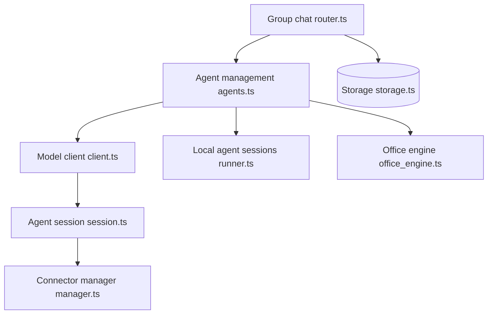

# Orkas-AI/Orkas

> Application de bureau où un « Commander » orchestre des agents spécialisés et tes CLI Claude Code, Codex.

## Le problème
Tu jongles entre plusieurs agents (code, recherche, contenu, fichiers Office) sans mémoire de projet commune ni suivi des tâches.

## Ce que ça fait vraiment
- Un Commander découpe un objectif en to-dos et délègue via `dispatch_to`, `hand_off_to` et `run_worker`.
- 16 agents intégrés (recherche, PPTX, vidéo, UI, e-commerce, code) plus Claude Code, Codex, OpenCode, OpenClaw et Hermes-Agent lancés en sous-processus locaux.
- Projets avec mémoire, automatisations planifiées, connecteurs (Gmail, Slack, Notion, Stripe...) et index vectoriel SQLite local des documents.
- Données sur ton disque par défaut.

## Comment c'est branché


## Essayer
```bash
git clone https://github.com/Orkas-AI/Orkas.git
cd Orkas
./run.sh           # macOS / Linux
run.cmd            # Windows
```
Puis Settings → AI Providers pour ajouter une clé API. Installeur pour macOS et Windows sur le site.

## Coût et pièges
Appli empaquetée : compte requis, 500 crédits offerts, puis plans payants (dès 11,99 $/mois). Version source : tes propres clés, facturation du fournisseur. Premier lancement : téléchargements lourds (modèle d'embedding ~95 Mo, FFmpeg, whisper.cpp). Le modèle intégré passe par un service managé.

## Ce que ce n'est pas
Pas un LLM, pas un framework à embarquer. Partage de projets, synchro cloud et publication web ne sont que dans l'appli empaquetée, pas dans la version open source. Ne tourne pas ordinateur éteint.

## Alternatives
- LangChain : framework en code, si tu veux écrire l'orchestration.
- CrewAI : équipes d'agents définies en Python.
- OpenClaw : plateforme d'agent personnel avec messagerie.

## Pour toi
À surveiller : intéressant pour voir un orchestrateur multi-agents local avec CLI existants, mais orienté bureautique et contenu plus que data/MLOps, avec une partie utile réservée à l'appli payante.

