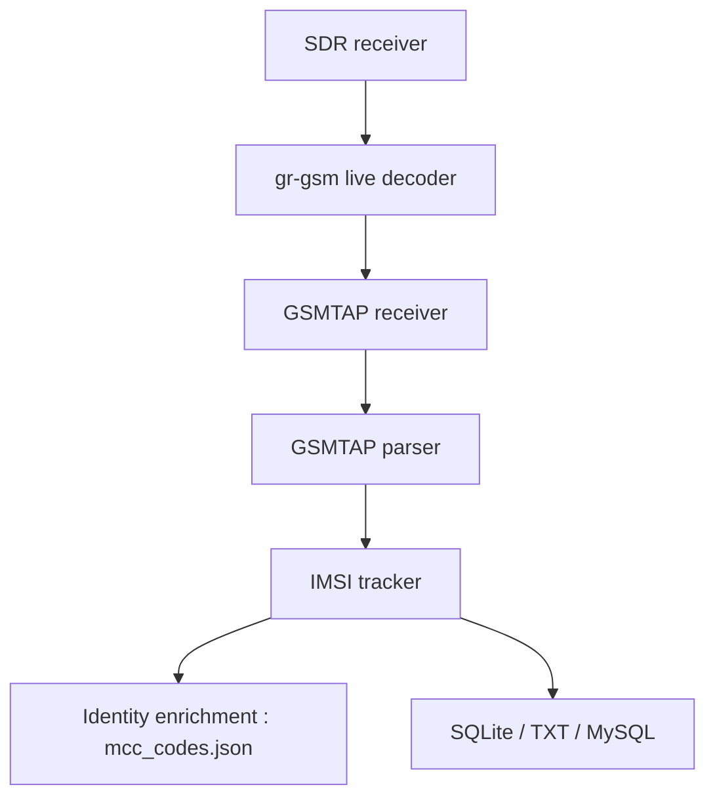

# Oros42/IMSI-catcher

> Program that displays IMSI numbers, countries and operators of nearby phones, for educational purposes about the GSM network.

## The problem
Understand how the GSM network works by observing the identities that circulate on it.

## What it actually does
Receives GSMTAP traffic decoded by gr-gsm, extracts IMSI and TMSI, adds country and operator via MCC/MNC codes, and displays or records them (SQLite, text, MySQL). You need a Linux PC and a software-defined radio (RTL2832U dongle, HackRF, BladeRF…).

## How it is wired


## Trying it
```bash
sudo apt install python3-numpy python3-scipy python3-scapy gr-gsm
python3 simple_IMSI-catcher.py -h
sudo python3 simple_IMSI-catcher.py -s
grgsm_livemon
```

## Cost and gotchas
Free on the software side; radio hardware needed (a dongle under $15 according to the README). Not Python 3.9. Capturing mobile identity data: check the legal framework.

## What it is not
The README states it is for understanding GSM, not for hacking. Not an AI tool.

## Alternatives
No alternative named in the README.

## For you
Ignore: outside the data/AI scope and legally sensitive; useful only for supervised radio research work.
