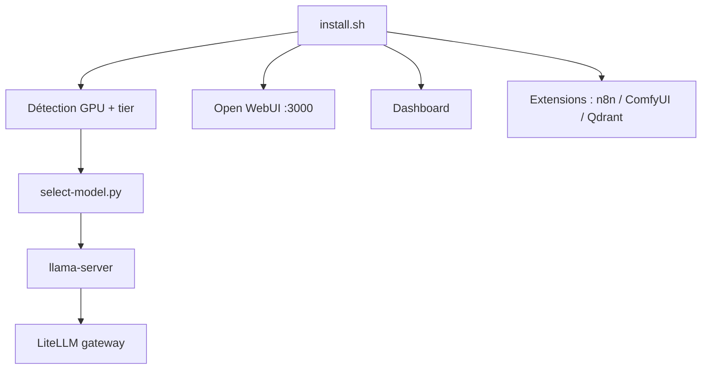

# Osmantic/ODS

> Installer that turns a PC/Mac/Linux machine into a complete, fully wired private AI server.

## The problem
Setting up a local AI server requires hand-assembling Ollama, Open WebUI, n8n, ComfyUI and privacy tools — Docker configs written from scratch, everything has to talk to everything. Many give up.

## What it actually does
One command detects the GPU, picks the suitable model, generates credentials and launches everything: local inference (llama-server), Open WebUI chat, control dashboard, voice (Whisper/Kokoro), agents (Hermes), n8n, RAG (Qdrant + embeddings), search (SearXNG/Perplexica), image (ComfyUI), privacy (Privacy Shield), observability (Langfuse). Hardware auto-detection with a model catalog per tier (NVIDIA/AMD Strix Halo/Apple/Intel Arc). Each service is a hot-pluggable extension. Bootstrap mode: small model in <1 min then hot-swap.

## How it is wired


## Trying it
```bash
curl -fsSL https://install.osmantic.com/ods.sh | bash
```
```bash
ods status
ods model swap T3
```

## Cost and gotchas
Local core is free. Optional cloud mode (`./install.sh --cloud`) via OpenAI/Anthropic/Together, keys at your expense. Docker required (Docker Desktop + WSL2 on Windows). The hosted install endpoint proxies `main`: check the script (Installer Trust). Single maintainer.

## What it is not
Not a model nor a hosted service: an installation orchestrator that wires existing third-party projects together.

## Alternatives
- Ollama + Open WebUI: LLM + chat only.
- LocalAI: LLM only.
- n8n self-hosted AI starter kits: automation only.

## For you
Attractive for quickly standing up a complete private AI lab; keep watching (single maintainer, hosted install endpoint).
