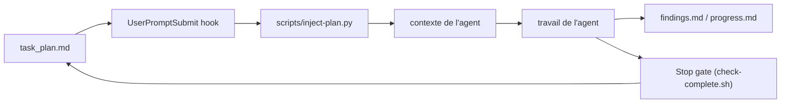

# OthmanAdi/planning-with-files

> A skill that keeps an agent's plan on disk and reinjects it at every turn.

## The problem
A `/clear`, a compaction or a crash wipes the working memory: the agent rediscovers what it has already done.
After fifty tool calls, the initial goal falls out of the attention window.

## What it actually does
Three markdown files: `task_plan.md` (phases and checkboxes), `findings.md` (notes), `progress.md` (log).
`SessionStart`, `UserPromptSubmit` and `PreCompact` hooks reinject the current phase into the context.
"Gated" mode: a Stop hook holds back stopping as long as a phase remains `in_progress`, with a blocking cap and stagnation detection.
SHA-256 attestation: a plan modified without approval is refused at injection with `[PLAN TAMPERED]`; `/plan-doctor` checks the installation.

## How it is wired


## Trying it
```bash
npx skills add OthmanAdi/planning-with-files --skill planning-with-files -g
npm install planning-with-files
pi install npm:planning-with-files
hermes plugins install OthmanAdi/planning-with-files/.hermes/plugins/planning-with-files
dsh plugin --profile web add dsh-planning-with-files
```

## Cost and gotchas
Free, but the "skill" route can install silently without hooks — yet the hooks are the whole mechanism.
Plan files are gitignored and not archived: the next task overwrites the root plan.

## What it is not
It is not agent memory: it manages the current execution state, not the retrieval of past facts.
It is not an up-to-date measured result: the 5.0 turns versus 13.3 come from an internal, self-administered benchmark, on a default behavior that has since changed.
It is not a deliverable: whatever must survive has to be promoted to code, a commit or a document.
The README provided here is truncated in the middle of the version history.

## Alternatives
Claude Code's plan mode: complementary, it designs the approach before execution whereas this skill persists state during it.

## For you
Useful for long, autonomous tasks; install via the plugin route then check with `/plan-doctor`, otherwise you will have nothing.
