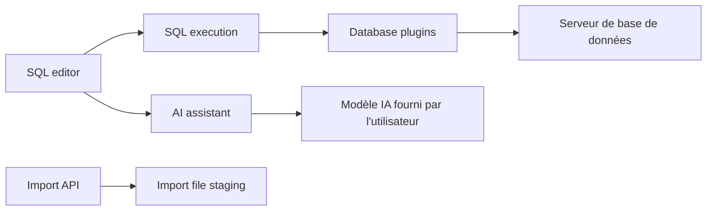

# OtterMind/Chat2DB

> A cross-platform database client with an AI assistant that generates and optimizes SQL.

## The problem
Writing and optimizing SQL across many databases requires several clients and a lot of manual work.

## What it actually does
A SQL workspace (editing, completion, execution, history), metadata and table management, ER diagrams, import/export, dashboards and a CLI with MCP. More than 40 databases are supported. The assistant uses your own AI model. Passwords and API keys are encrypted with AES-256-GCM using one key per installation.

## How it is wired


## Trying it
```bash
./script/security/init-community-encryption-key.sh
docker compose --file docker/docker-compose.yml up --detach
```

## Cost and gotchas
Free; the AI is at your expense. In Docker mode, the encryption key must exist and be backed up: losing it makes passwords unreadable. Service bound to `127.0.0.1`; do not expose it. Custom JDBC drivers are executable code.

## What it is not
Not multi-user: no accounts and no permission separation. License not identified by GitHub.

## Alternatives
No alternative named in the README.

## For you
Worth watching: handy for exploring databases with a SQL assistant, but check the license before business use.
