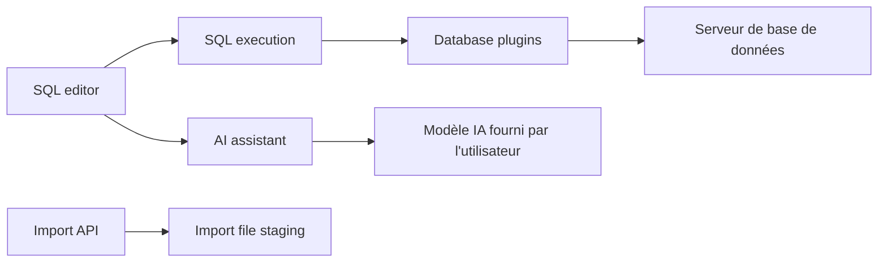

# OtterMind/Chat2DB

> Client de bases de données multiplateforme avec assistant IA qui génère et optimise du SQL.

## Le problème
Écrire et optimiser du SQL sur de nombreuses bases demande plusieurs clients et beaucoup de manipulations manuelles.

## Ce que ça fait vraiment
Un espace SQL (édition, complétion, exécution, historique), la gestion des métadonnées et tables, des diagrammes ER, l'import/export, des tableaux de bord et une CLI avec MCP. Plus de 40 bases sont prises en charge. L'assistant utilise ton propre modèle IA. Les mots de passe et clés d'API sont chiffrés en AES-256-GCM avec une clé par installation.

## Comment c'est branché


## Essayer
```bash
./script/security/init-community-encryption-key.sh
docker compose --file docker/docker-compose.yml up --detach
```

## Coût et pièges
Gratuit ; l'IA est à ta charge. En mode Docker, la clé de chiffrement doit exister et être sauvegardée : la perdre rend les mots de passe illisibles. Service lié à `127.0.0.1` ; ne pas l'exposer. Les pilotes JDBC personnalisés sont du code exécutable.

## Ce que ce n'est pas
Pas multi-utilisateur : aucun compte ni séparation des droits. Licence non identifiée par GitHub.

## Alternatives
Aucune alternative nommée dans le README.

## Pour toi
À surveiller : pratique pour explorer des bases avec un assistant SQL, mais vérifie la licence avant un usage en entreprise.

