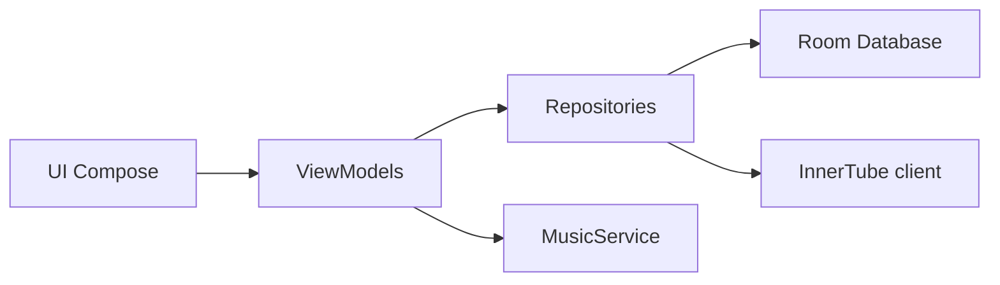

# OuterTune/OuterTune

> Material 3 Android music player, YouTube Music client, now abandoned by its author.

## The problem
Listening to YouTube Music and local files without ads in a single Android app.

## What it actually does
Fork of InnerTune: YouTube Music playback, offline download, local playback, synced lyrics, multiple queues, audio normalization, Android Auto. Architecture: Compose UI, ViewModels, Room, MusicService/ExoPlayer, innertube, kugou and lrclib modules.

## How it is wired

## Trying it
No command: the README announces that the app is no longer developed.

## Cost and gotchas
Unusable outside regions covered by YouTube Music without a VPN. It circumvents the service and has no link with Google.

## What it is not
No longer maintained. The README points to InterTune, AsterTune, Metrolist, ArchiveTune; for local playback, Gramophone.

## Alternatives
- Metrolist: fork cited and still active according to the README.
- Gramophone: for a purely local player.

## For you
Ignore: abandoned by its author and unrelated to your field.
