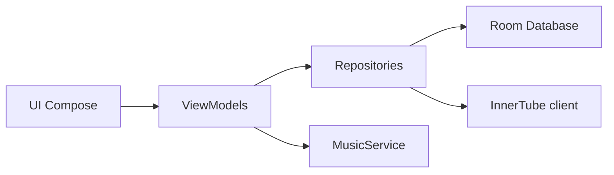

# OuterTune/OuterTune

> Lecteur de musique Android Material 3, client YouTube Music, désormais abandonné par son auteur.

## Le problème
Écouter YouTube Music et fichiers locaux sans publicité dans une même appli Android.

## Ce que ça fait vraiment
Fork d'InnerTune : lecture YouTube Music, téléchargement hors ligne, lecture locale, paroles synchronisées, files multiples, normalisation audio, Android Auto. Architecture : UI Compose, ViewModels, Room, MusicService/ExoPlayer, modules innertube, kugou, lrclib.

## Comment c'est branché

## Essayer
Aucune commande : le README annonce que l'appli n'est plus développée.

## Coût et pièges
Inutilisable hors régions couvertes par YouTube Music sans VPN. Contourne le service sans lien avec Google.

## Ce que ce n'est pas
Plus maintenu. Le README oriente vers InterTune, AsterTune, Metrolist, ArchiveTune ; pour du local, Gramophone.

## Alternatives
- Metrolist : fork cité et toujours actif selon le README.
- Gramophone : pour un lecteur purement local.

## Pour toi
À ignorer : abandonné par son auteur et sans lien avec ton métier.

