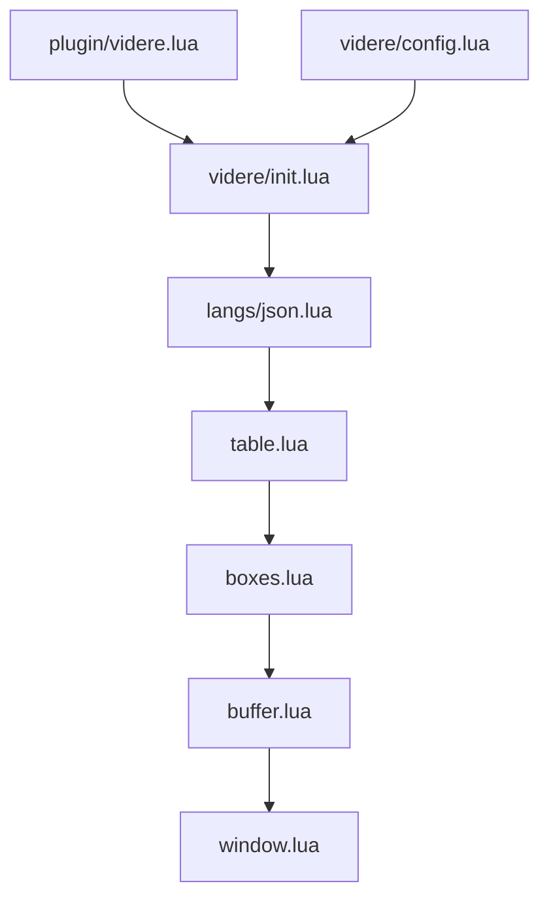

# Owen-Dechow/videre.nvim

> Neovim plugin that displays and edits JSON, YAML, TOML or XML files as a graph of cells.

## The problem
A terminal offers no graph view of nested configuration files, like JSON Crack does in a graphical interface.

## What it actually does
The Videre command opens a window that draws the file as linked, collapsible cells. You jump between linked cells, set a root and edit keys, values and types. JSON is native; YAML, TOML and XML require a parser plugin.

## How it is wired


## Trying it
```lua
return {
  "Owen-Dechow/videre.nvim",
  cmd = "Videre",
  opts = { box_style = "sharp" },
}
```
Then open a JSON file and run `:Videre`.

## Cost and gotchas
Free. Requires Neovim and a plugin manager (lazy.nvim or vim.pack). XML support is experimental.

## What it is not
Not a data editor: it displays and modifies a file's structure, without schema validation.

## Alternatives
JSON Crack: cited as a reference, with a graphical interface that Neovim does not offer.

## For you
Worth watching: useful if you often read large YAML or JSON configs in Neovim, of no interest otherwise.
