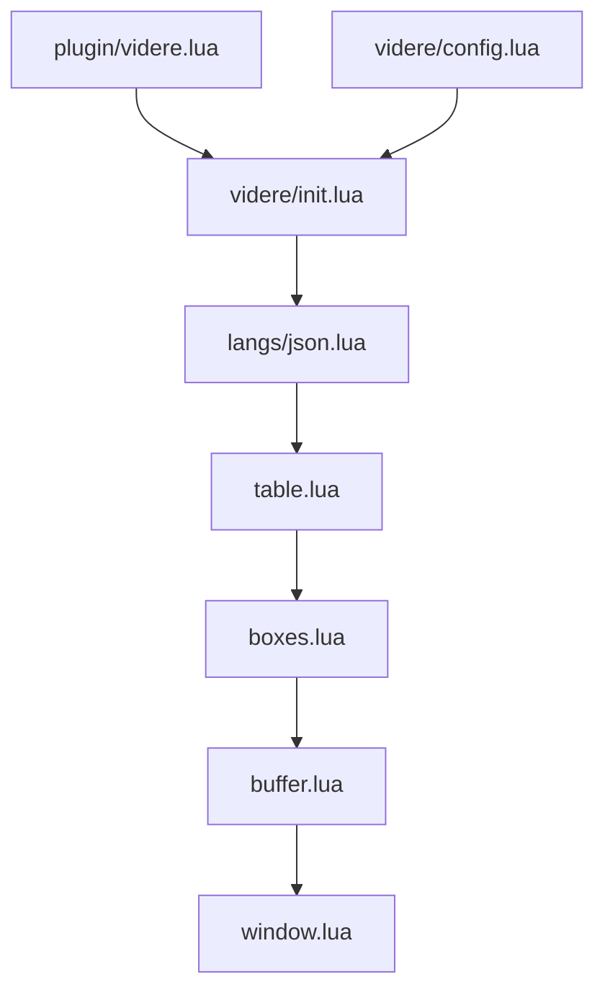

# Owen-Dechow/videre.nvim

> Plugin Neovim qui affiche et édite des fichiers JSON, YAML, TOML ou XML sous forme de graphe de cellules.

## Le problème
Un terminal n'offre pas de vue en graphe des fichiers de configuration imbriqués, comme JSON Crack dans une interface graphique.

## Ce que ça fait vraiment
La commande Videre ouvre une fenêtre qui dessine le fichier en cellules reliées, repliables. On saute entre cellules liées, on définit une racine et on modifie clés, valeurs et types. JSON est natif ; YAML, TOML et XML demandent un plugin parseur.

## Comment c'est branché


## Essayer
```lua
return {
  "Owen-Dechow/videre.nvim",
  cmd = "Videre",
  opts = { box_style = "sharp" },
}
```
Puis ouvrir un fichier JSON et lancer `:Videre`.

## Coût et pièges
Gratuit. Il faut Neovim et un gestionnaire de plugins (lazy.nvim ou vim.pack). Le support XML est expérimental.

## Ce que ce n'est pas
Pas un éditeur de données : il affiche et modifie la structure d'un fichier, sans validation de schéma.

## Alternatives
JSON Crack : cité en référence, avec une interface graphique que Neovim n'offre pas.

## Pour toi
À surveiller : utile si tu lis souvent des configs YAML ou JSON volumineuses dans Neovim, sans intérêt autrement.

